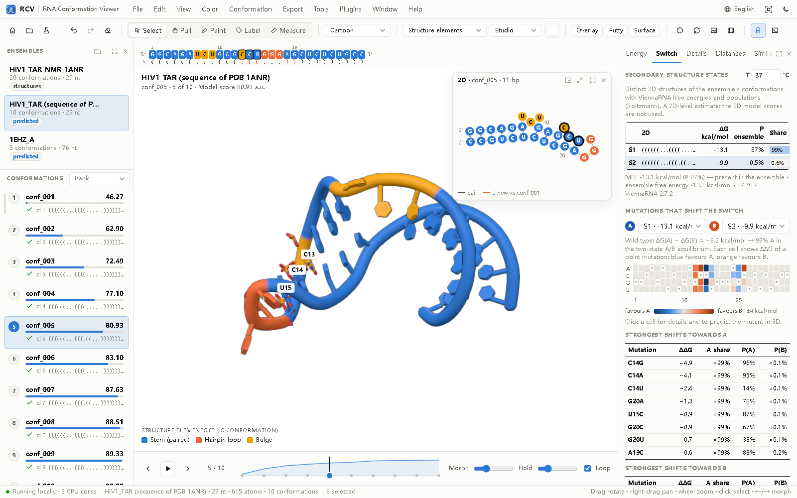
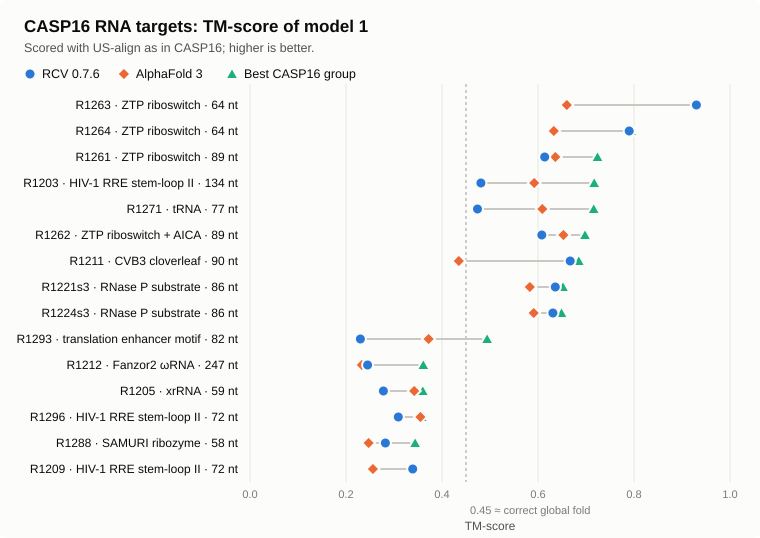
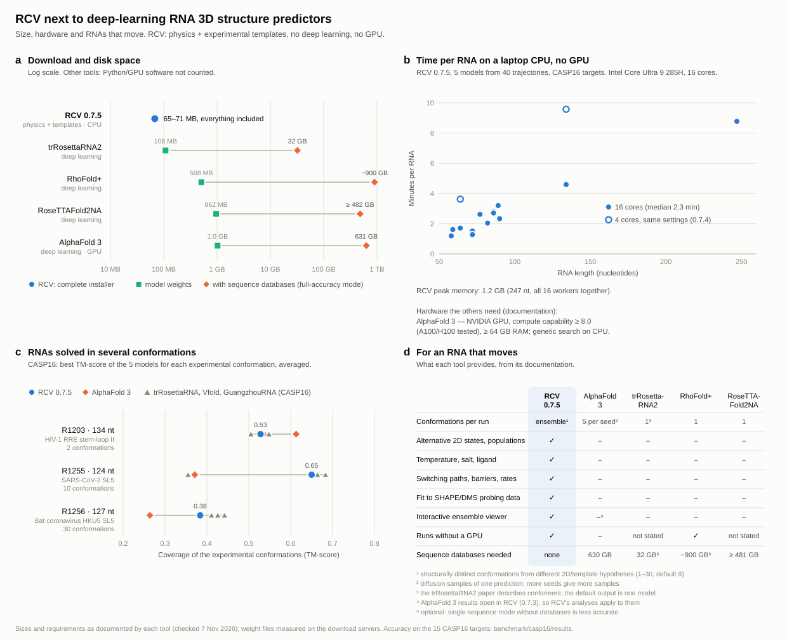

# RCV: RNA Conformation Viewer

[](https://doi.org/10.5281/zenodo.24163503)


**The RNA conformational ensemble, from sequence to figure, on your own computer.**

RCV is a free, open-source desktop application that predicts the 3D conformations an RNA can adopt, shows how
it switches between them, and turns the result into publication-ready figures. It combines a physics- and
template-based structure engine, ensemble and switching analysis, and an interactive 3D/2D viewer in one
program. Everything runs locally on a laptop CPU: no GPU, no cloud service, no account, and no data leave the
computer.

### Why RCV

* **Ensembles, not a single answer.** RCV returns a ranked set of distinct, validated all-atom conformations,
  the Boltzmann populations of their 2D states, and the refolding pathway between any two of them (barrier,
  routes, rate-limiting motions, mutations that speed the switch up or slow it down). Most structure tools stop at
  one model.
* **Accuracy of AlphaFold 3, without deep learning.** On the 15 blind CASP16 RNA targets RCV's first model
  reaches a mean TM-score of 0.501, against 0.480 for AlphaFold 3, scored the same way with US-align
  ([benchmark](#comparison-with-leading-predictors-casp16)). It takes 1–8 minutes per RNA on a laptop CPU and
  ships as a ~70 MB installer; AlphaFold 3 needs 1 GB of weights and 630 GB of databases.
* **Made for RNAs that move.** Riboswitches, thermometers and other switches: drag a residue and the model
  moves to the nearest stable conformation; scan point mutations for their effect on the switch; set
  temperature, salt and ligand; fit the ensemble to SHAPE/DMS, SAXS, FRET or cryo-EM data.
* **Chemistry beyond A, C, G, U.** 97 modified nucleotides (m6A, Ψ, m1Ψ, inosine, 2′-O-methyl, LNA,
  phosphorothioate…) in the 2D and 3D prediction, and left-handed Z-RNA marked automatically in every frame.
* **Reproducible and citable.** Deterministic runs for a given seed, an independent all-atom validation of
  every model, provenance and an auto-generated methods paragraph in an open file format (`.rcv`), a Zenodo DOI.

RCV is for researchers in RNA biology, structural biology, RNA therapeutics and computational biology. It runs
on Linux, Windows and macOS, in eleven interface languages.

**Keywords**: RNA 3D structure prediction, RNA conformational ensemble, RNA conformational switching,
riboswitch, modified nucleotides, Z-RNA, molecular visualization, bioinformatics software.

**Author:** Zixiang Wang · princewang2018@gmail.com



## Download

Desktop installers for **RCV 0.7.6**. Python, the prediction engine, ViennaRNA, the demo data and the user guide
are included; nothing else needs to be installed.

| Platform | Installer | Notes |
|---|---|---|
| **Linux**: Debian, Ubuntu, Linux Mint | [RCV-0.7.6-Linux-amd64.deb](https://www.rnaconfviewer.com/download/v0.7.6/RCV-0.7.6-Linux-amd64.deb) | Ubuntu 20.04, Debian 11 or newer; adds the `rcv` command and a menu entry |
| **Linux**: Fedora, RHEL, Rocky, AlmaLinux, openSUSE | [RCV-0.7.6-Linux-x86_64.rpm](https://www.rnaconfviewer.com/download/v0.7.6/RCV-0.7.6-Linux-x86_64.rpm) | Fedora 32, RHEL 9, openSUSE Leap 15.6 or newer |
| **Windows** 10/11 (64-bit) | [RCV-0.7.6-Windows-x64-Setup.exe](https://www.rnaconfviewer.com/download/v0.7.6/RCV-0.7.6-Windows-x64-Setup.exe) | Start-menu entries and optional `.rcv` file association |
| **Windows** 10/11 (64-bit) | [Microsoft Store](https://www.rnaconfviewer.com/store) | Signed by Microsoft, installs without a SmartScreen prompt, updated by the Store |
| **macOS** 14+ (Apple Silicon) | [RCV-0.7.6-macOS-arm64.dmg](https://www.rnaconfviewer.com/download/v0.7.6/RCV-0.7.6-macOS-arm64.dmg) | Macs with an M-series chip (M1 and later) |
| **macOS** 14+ (Intel) | [RCV-0.7.6-macOS-x86_64.dmg](https://www.rnaconfviewer.com/download/v0.7.6/RCV-0.7.6-macOS-x86_64.dmg) | Intel-based Macs |

<a href="https://www.rnaconfviewer.com/store"></a>

Checksums ([SHA256SUMS.txt](https://www.rnaconfviewer.com/download/v0.7.6/SHA256SUMS.txt)), release notes and
earlier versions: [www.rnaconfviewer.com](https://www.rnaconfviewer.com/#download). To run from source instead, see
[Install](#install).

## Features

### Core features

* **Prediction from sequence** — paste a sequence or a multi-sequence FASTA (batch): template search in a
  built-in library of 3,964 PDB RNA chains, 2D hypotheses from the templates and ViennaRNA, all-atom 3D models
  folded by physics, validated and ranked.
* **Open any structure** — NMR ensembles, MD snapshots, models of any predictor (PDB/mmCIF; several files of one
  RNA open as one ensemble), AlphaFold Server results, or *Fetch from the PDB*.
* **Linked 3D and 2D** — the secondary structure of the shown conformation, with shared colours, hover and
  selection, morphing in step with the 3D view.
* **Pull to switch** — drag a residue: the structure moves to the nearest stable computed conformation;
  *Explore* searches for new ones.
* **Switch analysis** — Boltzmann populations of the 2D states at any temperature, and a point-mutation scan
  ranking the mutations that shift the switch, each one click from a 3D prediction.
* **Pathways: how A turns into B** — refolding barrier and routes (transition-path theory), time to switch,
  traps, the cooperative unit of base pairs, rigid modules and the rate-limiting motion, a φ-value scan and a
  mechanism morph ([validation](docs/V07_VALIDATION.md)).
* **Topology-aware ensemble map** — every secondary-structure topology in its own region, conformations placed
  by 3D similarity, switching routes on top.
* **Conditions and data** — temperature, Na⁺ and ligand binding; agreement with SHAPE/DMS, SAXS, FRET and
  cryo-EM data and maximum-entropy reweighting of the ensemble.
* **Z-RNA identification** *(new in 0.7.6)* — left-handed helices found and marked in every displayed frame,
  high-confidence regions only (no false region in the 3,964 chains of the template library); on by default.
* **Publication output** — figures (PNG/TIFF/PDF), multi-conformation panels with 2D drawings, a plot studio
  (RMSD matrix, RMSF, funnel, energy profile), colour-blind-safe palettes, surfaces, transition videos, an
  interactive single-file HTML page and a methods paragraph.
* **Command console and command line** — an RNA-ensemble selection language (`helix H2`, `switching`,
  `rmsf > 3`), familiar molecular-viewer commands, scenes and measurements; `rcv convert / info / extract /
  batch / html` without the window.
* **One file per RNA** — the open `.rcv` format holds every conformation with energies, 2D structures,
  validation, provenance and the view, 10–14× smaller than PDB.
* **Your language, your layout, your plugins** — English, 简体中文, 繁體中文, 日本語, 한국어, Español,
  Français, Deutsch, Italiano, Português and Русский; every panel can be shown, hidden or maximised; JavaScript
  and Python plugins ([developer guide](docs/PLUGINS.md)).

### Experimental and optional features

These work and are tested, but their accuracy is not yet established on a benchmark of their own, or they rely
on software outside RCV. Each one says so where it is used.

* **Modified nucleotides** *(0.7.6)* — 97 modifications in the 2D prediction (ViennaRNA's measured parameters
  where they exist, estimated corrections otherwise) and in the 3D search (pucker, syn/anti, the modification's
  own hydrogen bonds, water bridge and stacking). Notation `GGC[m6A]CU[Y]A*G`; an editor on the start page.
* **Z-RNA prediction** *(0.7.6, off by default)* — builds a helix segment as left-handed Z-form when its
  estimated A→Z free energy (sequence, salt, 8-substituted purines, Z-binding protein) is favourable;
  *Advanced settings* on the start page; about 25–50 % longer runs.
* **Conformation-selective compound screening** *(0.7.5)* — pockets of each conformation, docking of a compound
  library against two of them, and a ranking by selectivity. A ranking to choose compounds to test, never an
  affinity ([measured performance](docs/SCREENING_STATUS.md)).
* **Advanced analyses inside the tabs** *(0.7.4)* — experiments that tell two states apart (disrupt-and-rescue
  mutants, probing segments, FRET/DEER label pairs), effects of variants, co-transcriptional folding, motifs and
  tertiary contacts, antisense target sites, comparison with another ensemble.
* **Per-nucleotide confidence** — a small neural network (numpy, any laptop) estimates the local accuracy
  (lDDT) of every nucleotide.
* **AlphaFold 3 inside RCV** — run your own AlphaFold 3 installation from the start page; AlphaFold 3 is not
  included in RCV.

User guide: **[docs/RCV.md](docs/RCV.md)** · plugins: **[docs/PLUGINS.md](docs/PLUGINS.md)** · installers:
**[packaging/README.md](packaging/README.md)** · engine status and benchmark: **[docs/V2_STATUS.md](docs/V2_STATUS.md)** ·
changes: **[CHANGELOG.md](CHANGELOG.md)**.

## Prediction engine (rnafold3d)

```
FASTA ──► template search: Smith–Waterman against 3,964 PDB RNA chains (E-values; ranked by 3D agreement)
      ──► 2D hypotheses: template base pairs (rest folded by ViennaRNA) + ViennaRNA MFE and suboptimals
      ──► rigid all-atom A-form stems (calibrated geometry, exact covalent chemistry)
      ──► fold-tree search in torsion space (annealing; template / junction-geometry distance restraints)
      ──► loop closure (restrained to the template loop shape) + clash relief
      ──► Cartesian refinement onto template atoms; regularisation of strained models
      ──► independent all-atom validation (fail-closed)
      ──► ranked, structurally distinct ensemble: PDB + mmCIF + manifest.json
```

**Status (engine v2.5.0, 2026-11-20):** valid all-atom ensembles from sequence for 26/26 pilot benchmark targets
(14–192 nt). With a related experimental structure in the built-in library the models follow it closely (CASP16
ZTP riboswitch: TM-score 0.93); without one, large multi-branched RNAs stay near random-arrangement accuracy. On
the blind CASP16 targets RCV with templates is as accurate as AlphaFold 3 on average and behind the best expert
groups — see [Comparison with leading predictors (CASP16)](#comparison-with-leading-predictors-casp16).
Details, benchmark results and limitations: **[docs/V2_STATUS.md](docs/V2_STATUS.md)**, tables in
`docs/benchmark_v1/`, and
`RNAFold3D_Project_Progress_and_Next_Steps.md`. Earlier milestone notes (M0-M4, guide-site
engine) are in `docs/milestones/`; the original archives (`*.zip`) are kept unchanged.

## Install

Python >= 3.10 with `numpy`, `scipy`; `ViennaRNA` (python module `RNA`) for sequence-only
prediction (`conda install -c bioconda viennarna` or `pip install ViennaRNA`; an external dependency under its own licence: this source
repository does not contain it, the desktop installers bundle it with credit as its licence allows, see
`packaging/THIRD-PARTY-NOTICES.txt`). Optional: `threadpoolctl`.

```bash
pip install -e .            # or: export PYTHONPATH=src
```

## Use

```bash
# sequence only (2D predicted by ViennaRNA)
python -m rnafold3d predict --fasta my_rna.fa --models 5 --seed 42 --out runs/my_rna --workers 8

# with a known secondary structure (dot-bracket; pseudoknotted pairs are dropped with a warning)
python -m rnafold3d predict --fasta my_rna.fa --dbn my_rna.dbn --models 5 --out runs/my_rna_2d

# independent validation of any PDB/mmCIF
python -m rnafold3d validate runs/my_rna/conformations/conf_001.pdb

# package an external ensemble (e.g. NMR models) in the same format the viewer will read
python -m rnafold3d import model_*.pdb --out ensembles/my_nmr --name my_nmr

# 2D hypotheses only
python -m rnafold3d ss --fasta my_rna.fa

# RCV app with a run folder, an .rcv file, an NMR/multi-model file, or several models of one RNA
rcv runs/my_rna
rcv models/*.pdb --chain A                     # several files of one RNA = one ensemble (wildcards work on Windows too)
rcv convert runs/my_rna -o my_rna.rcv          # one compact file with every conformation
rcv info my_rna.rcv --methods                   # what it contains (+ methods paragraph)
rcv extract my_rna.rcv -o pdb/                  # back to PDB files
rcv ss my_rna.rcv -o my_rna.dbn                 # sequence + 2D structures as dot-bracket (or .ct, .bpseq)
rcv batch my_rnas.fasta                         # predict every sequence (one .rcv each)
rcv html my_rna.rcv -o my_rna.html              # interactive single-file web page
rcv export-document runs/my_rna --out my_rna.json   # ensemble document without the GUI
```

Output package (`runs/my_rna/`):

```
input/sequence.fasta, input/secondary_structures.dbn
conformations/conf_001.pdb, conf_001.cif, ...      chain A, residues 1..N, heavy atoms
metadata/manifest.json   schema rnafold3d.ensemble/1 (schemas/ensemble_manifest.schema.json)
metadata/scores.csv      every trajectory: status, score terms, cluster
metadata/clusters.json   greedy C4'-RMSD clusters (sampling statistics, not populations)
metadata/validation.json per-trajectory validation and loop-closure reports
config.json, logs/run.log
```

Runs are deterministic for a given seed and package version (independent of worker count).

## Comparison with leading predictors (CASP16)

CASP16 (2024) is the latest community-wide blind test of RNA 3D structure prediction. RCV 0.7.6 predicted its
15 single-chain RNA targets up to 250 nt from the sequence (5 models, *thorough* sampling, 1–8 minutes per target,
median 2, on a laptop CPU with 16 cores, Intel Core Ultra 9 285H, no GPU), using as templates only structures released
before 2024-05-01, the start of the CASP16 season. RCV's models and the models submitted to CASP16 by AlphaFold 3, the
trRosettaRNA server and two of the top expert groups (Vfold, GuangzhouRNA) were all scored the same way, with
US-align as in the official assessment (the official CASP16 numbers are reproduced).

<p align="center"></p>

| Method | Mean TM-score, model 1 | Mean TM-score, best of 5 | Median RMSD, model 1 (Å) | Correct global fold (TM ≥ 0.45) | Base pairs right (INF-WC) |
|---|---|---|---|---|---|
| **RCV 0.7.6, physics + templates, no deep learning** | **0.501** | **0.527** | 6.0 | 9 of 15 | 0.81 |
| RCV 0.7.5 | 0.495 | 0.527 | 7.8 | 8 of 15 | 0.81 |
| RCV 0.7.3 | 0.490 | 0.511 | 10.7 | 8 of 15 | 0.83 |
| RCV 0.7.2, physics only | 0.251 | 0.283 | 15.3 | 0 of 15 | 0.75 |
| AlphaFold 3 (AF3-server) | 0.480 | 0.501 | 8.6 | 8 of 15 | 0.92 |
| trRosettaRNA (Yang-Server) | 0.493 | 0.539 | 9.4 | 9 of 15 | 0.85 |
| Vfold | 0.534 | 0.565 | 3.5 | 10 of 15 | 0.91 |
| GuangzhouRNA-human | 0.526 | 0.548 | 5.8 | 9 of 15 | 0.93 |

**What it means.** With templates, RCV's first model is on average as accurate as AlphaFold 3's (0.501 vs
0.480; best of 5 0.527 vs 0.501) and has the right global fold on 9 of 15 targets (AlphaFold 3: 8; 0.7.2: none);
the two expert groups remain ahead. Where a related structure exists (9 targets) RCV's models follow it closely:
0.65 on average (AlphaFold 3 0.60), e.g. ZTP riboswitch R1263 0.93 (0.66), CVB3 cloverleaf R1211 0.67 (0.43); RCV
is behind on R1203, R1261/R1262 and the tRNA R1271, where the closest earlier structure differs more. On the 6
targets without a template, which the whole field found hard, RCV has 0.28 (0.7.3: 0.26; AlphaFold 3 0.30): in
0.7.5 hairpin loops take their shape from library loops with a matching sequence (R1209 0.25 → 0.34). Against the
engine without these fragments the change in mean model-1 TM-score is +0.006 (95% interval −0.016 to +0.026), so
15 targets cannot establish it; the median RMSD of model 1 fell from 10.7 to 7.8 Å. In 0.7.6 (engine 2.5.0) the
last step of a template model, the fit onto the template, is repeated with the offending residues released
instead of given up: model 1 0.495 → 0.501 (95% interval −0.000 to +0.017; the tRNA R1271 0.39 → 0.47, the
other targets unchanged), median RMSD 7.8 → 6.0 Å. The 15 targets took 38 minutes in
all (0.7.5: 41); side by side on one target, a 0.7.6 run takes 5–13 % longer than a 0.7.5 run.

**RNAs that move.** Three CASP16 RNAs were solved in several conformations (R1203: 2, R1255: 10, R1256: 30).
How well the five models cover all of them, and the size, hardware and features of RCV next to AlphaFold 3,
RoseTTAFold2NA, RhoFold+ and trRosettaRNA2:

<p align="center"></p>

Per-target tables and method notes: [benchmark/casp16/results](benchmark/casp16/results/README.md),
[ENSEMBLES.md](benchmark/casp16/results/ENSEMBLES.md). Reproduce: `python benchmark/casp16/compare.py fetch --models &&
python benchmark/casp16/compare.py run && python benchmark/casp16/compare.py evaluate` (needs ViennaRNA and US-align).

## Benchmark

```bash
python benchmark/build_dataset.py              # 26 experimental targets, 14-192 nt (benchmark/manifest_v1.json)
python benchmark/run_benchmark.py --run-id v2 --split test --modes independent,oracle
python benchmark/legacy_baseline.py            # legacy M1-M3 pipeline on the same targets
```

`independent` = FASTA only; `oracle` = 2D annotated from the reference structure (upper bound for
3D assembly; never to be reported as sequence-only accuracy).

## Tests

```bash
PYTHONPATH=src python -m unittest discover -s tests     # engine + app (+ JS units if Node.js is installed)
python tools/viewer_smoketest.py                          # 83 GUI scenarios in headless Edge/Chrome, with screenshots
```

## How to cite

If you use RCV in your work, please cite it through its Zenodo DOI
([10.5281/zenodo.24163503](https://doi.org/10.5281/zenodo.24163503), which always resolves to the latest release):

```text
Wang Z. RCV: RNA Conformation Viewer (2026). Zenodo. https://doi.org/10.5281/zenodo.24163503
```

```bibtex
@software{wang_rcv_2026,
  author    = {Wang, Zixiang},
  title     = {{RCV: RNA Conformation Viewer}},
  year      = {2026},
  publisher = {Zenodo},
  doi       = {10.5281/zenodo.24163503},
  url       = {https://doi.org/10.5281/zenodo.24163503}
}
```

GitHub's *Cite this repository* button (from [CITATION.cff](CITATION.cff)) gives the same reference in APA and
BibTeX. Please also cite ViennaRNA when you use predictions from sequence: Lorenz R. et al. ViennaRNA Package 2.0.
*Algorithms for Molecular Biology* 6, 26 (2011).

## Layout

```
src/rnafold3d/
  v2 engine: structure_io, geomutil, build, fold, loops, search, checks, ss, predict, metrics,
             annotate, ensemble_io, cli; data/geometry_v1.json (calibrated parameters)
  templates.py (template library and search), motifs.py (junction geometry), cartesian.py (Cartesian
             refinement); data/pdb_rna_v2.npz (3,964 PDB RNA chains, built by tools/build_template_library.py)
  evaluate.py  model-independent conformation energy terms (used by the app)
  screening/   compound screening: pockets.py (where a compound could bind), chem.py (compounds),
             receptor.py (the RNA as a receptor), score.py + grid.py (the scoring function), dock.py
             (the search), screen.py (a library against two conformations)
src/rcv/
  app.py (entry point, CLI tools, `engine` passthrough), server.py (local API), jobs.py (predictions, batches,
  pull explorations), alphafold.py (AlphaFold 3 runs and AlphaFold Server results), data.py (ensemble
  documents, 2D layouts, what is bound to the RNA), rcvfile.py (.rcv format), switch.py (2D switch analysis),
  transition.py (pathways), landscape.py (ensemble map), conditions.py, probing.py, expdata.py, insight.py
  (advanced analyses), screening.py, library.py, recipes.py, methods.py, htmlexport.py, ss2dexport.py (dot-bracket, CT, BPSEQ),
  fonts.py (PDF font subsets), desktop.py (window shells, native dialogs), paths.py, templates/ (plugin templates),
  static/ (GUI: HTML/CSS/ES modules incl. console/, panels/, export/, viewer/; three.js r160 vendored under
  its MIT license; Liberation Sans under the SIL OFL 1.1; built-in plugins)
packaging/  PyInstaller spec, Windows (Inno Setup), macOS (.app/.dmg) and Linux (.deb/.rpm) build scripts, icons
  legacy M1-M4 guide-site modules (core, topology, assembly, closure, energy, sampling, atomistic, ...)
tools/      calibrate_geometry.py, refine_aform.py, loop_reach.py (parameter derivation),
            build_template_library.py (PDB RNA library);
            viewer_smoketest.py + viewer_harness/ (GUI test scenarios)
benchmark/  manifest, dataset builder, runner, legacy baseline, data/ (raw mmCIF git-ignored),
            dev_templates.py (template development benchmark), casp16/ (CASP16 comparison),
            screening/ (redocking, pocket sites and enrichment; they download their own data)
schemas/    ensemble manifest JSON schema (viewer contract)
tests/      legacy suite + test_v2_engine.py + test_app.py + test_pull_engine.py + test_rcv05.py + test_rcv06*.py
            + test_rcv07.py + test_v072.py … test_v076.py + test_v076_audit.py (0.7.6 audit fixes)
            + test_components.py (PDB chemical components) + test_zrna.py + test_screening.py
            (+ js/*.mjs: unit tests of the browser modules, run under Node.js)
docs/       RCV.md (user guide), PLUGINS.md (plugin developer guide), V2_STATUS.md, images/
examples/   viewer_demo/ (TAR NMR ensemble, TAR and tRNA predictions), viewer_plugins/ (Python plugin example),
            scripts/ (console script example)
```
