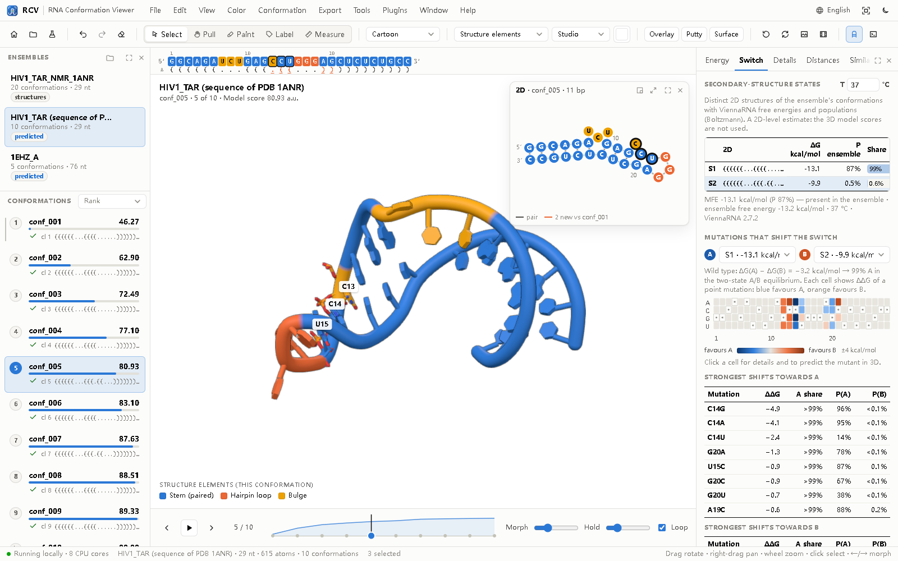
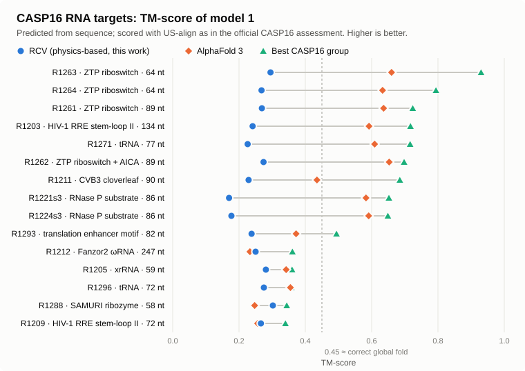
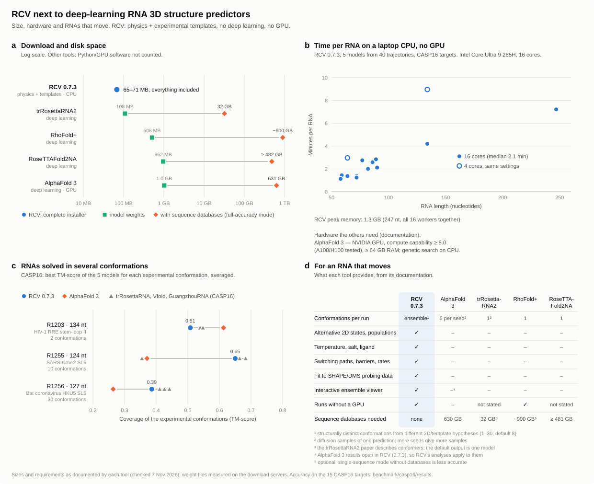

# RCV: RNA Conformation Viewer


**Predict, explore and present RNA conformations on your own computer.** RCV is a free, open-source desktop application for RNA 3D conformation prediction, interactive molecular visualization, conformational ensemble analysis, and RNA conformational switching studies.

Unlike tools focused only on displaying a single RNA structure, RCV combines 3D visualization with linked secondary-structure views, multi-conformation exploration, switching analysis, mutation scanning, and publication-ready figure generation.

RCV supports Windows, macOS, and Linux. It is designed for researchers in RNA biology, structural biology, computational biology, and bioinformatics.

**Keywords**: RNA 3D structure viewer, RNA conformation visualization, RNA conformational ensemble, RNA conformational switching, RNA structure analysis, molecular visualization, bioinformatics software.

**Author:** Zixiang Wang · princewang2018@gmail.com

* **3D models from related experimental structures** *(0.7.3)* — the engine searches a built-in library of
  3,964 RNA chains from the PDB (21.5 MB, no network) and builds on related structures (templates): base pairs,
  3D restraints, loop shapes and atom positions, with the rest of the RNA folded by physics. Without a template,
  junctions take geometries seen in experimental structures. No deep learning, no GPU: on the blind CASP16
  targets RCV's model 1 is as accurate as AlphaFold 3's on average, in 1–7 minutes per target on a laptop CPU
  ([comparison](#comparison-with-leading-predictors-casp16)).
* **AlphaFold 3 inside RCV** *(0.7.3, optional)* — run your own AlphaFold 3 installation from the start page
  (*Engine: AlphaFold 3 (local)*), or open the `.zip` downloaded from AlphaFold Server: all sampled models open
  as one ensemble coloured by pLDDT. AlphaFold 3 is not included in RCV.
* **Start page: the two ways to use RCV** *(0.7.1)* — **1 · predict RNA conformations from sequence(s)**: paste a
  sequence (empty = demo sequence) or a **multi-sequence FASTA for batch prediction** (live stages, time left,
  notes; choose which result to open), settings under *Advanced settings*; **2 · view experimental or predicted
  structures of one RNA**: open NMR ensembles, MD snapshots, models of any predictor, earlier runs or `.rcv` files
  (several files open together as one ensemble), or **fetch a PDB entry**.
* **A desktop program, not a web page** — mouse tools (select, pull, paint, label, measure), **undo / redo /
  clear**, RCV's own right-click menus, no accidental text selection; the command-line tools are in the
  **Tools** menu.
* **One file per RNA: `.rcv`** — every conformation with energies, 2D structures, validation, provenance and
  your view, 10–14× smaller than the same models as PDB; open format (ZIP + JSON), `rcv convert/info/extract`.
* **Pull to switch** — drag a residue: the structure stretches and switches to the nearest stable computed
  conformation; *Explore* runs the engine with the pull as a temporary bias to find new stable ones.
* **2D window linked to 3D** — the secondary structure of the shown conformation, coloured like the 3D view,
  with linked hover/selection, morphing in step with the 3D morph.
* **Switch analysis** — Boltzmann populations of the ensemble's 2D states (any temperature) and a mutation scan
  that ranks the point mutations shifting the switch towards A or B, with one-click *Predict in 3D*.
* **Pathways: how A turns into B** *(0.7)* — refolding paths and barriers between the basins of A and B (ViennaRNA
  findpath), routes through intermediates ranked by **transition-path-theory flux**, the mean first-passage time
  to switch, traps and a feasibility verdict; the **cooperative unit** of base pairs that must open together before
  the saddle; **rigid modules** and hinges between the two 3D models with the **rate-limiting coordinated motion**;
  an **in-silico φ-value scan** of every point mutation (which ones speed the switch up or slow it down); and a
  **mechanism morph** that plays the motion in order. Validated on the benchmark ensembles:
  [docs/V07_VALIDATION.md](docs/V07_VALIDATION.md).
* **Topology-aware ensemble map** *(0.7)* — every secondary-structure topology in its own disk, conformations placed
  by RMSD inside, routes drawn on top; quality reported against classical MDS.
* **Conditions, ligands and probing data** *(0.7)* — temperature, Na⁺ and ligand binding to an aptamer (switch
  dose–response); **SHAPE/DMS** profiles: agreement of every conformation and maximum-entropy **reweighting** of
  the ensemble.
* **Confidence model** *(0.7, optional)* — a small neural network (numpy, runs on any laptop) predicts the local
  accuracy of every nucleotide (lDDT) and colours the structure by it.
* **Command console** — an RNA-ensemble selection language (`helix H2`, `switching`, `rmsf > 3`, `within 5 of …`)
  and familiar molecular-viewer commands (select, show/hide, color, label, zoom/orient, distance/angle/dihedral,
  align/fit, scenes, png, fetch, scripts), plus a sequence bar, measurements and saved scenes.
* **Publication output** — figures (PNG/TIFF/PDF, vector energy panel), **multi-conformation figure panels**
  with 2D drawings, a **plot studio** (clustered RMSD matrix, RMSD to a reference, RMSF, funnel, energy profile;
  journal sizes in mm, vector PDF/SVG), **annotations** (labels, region brackets, notes), **colour palettes**
  (colour-blind-safe sets, your own, with a colour-vision check), **molecular surfaces** and per-object
  **transparency**, videos including **transition A → B** (directly or through intermediates), an
  **interactive single-file HTML page** for supplements and reviewers, and an auto-generated **methods text**.
  Figure text uses the bundled open-licence font Liberation Sans (SIL OFL), embedded in PDFs.
* **In your language, your layout** — interface in English, 简体中文, 繁體中文, 日本語, 한국어, Español, Français,
  Deutsch, Italiano, Português (Brasil) and Русский (figures stay in English); every panel and window can be
  shown, hidden or maximised, `H` keeps only the 3D view, `F11` full screen.
* **Local and extensible** — engine on your CPU cores, rendering on your GPU; JavaScript and Python plugins
  with a template generator and a **[developer guide](docs/PLUGINS.md)**.

**Download:** installers for Windows, macOS and Linux (.deb, .rpm) — Python, engine, ViennaRNA, demo data and help included — at
**[www.rnaconfviewer.com](https://www.rnaconfviewer.com/#download)**. From the source code:

```bash
pip install -e .            # or: export PYTHONPATH=src
rcv                         # opens the app (python -m rcv works too); rcv --demo for example data
```

User guide: **[docs/RCV.md](docs/RCV.md)** · plugins: **[docs/PLUGINS.md](docs/PLUGINS.md)** · installers: **[packaging/README.md](packaging/README.md)** ·
engine status and benchmark: **[docs/V2_STATUS.md](docs/V2_STATUS.md)**.



## Prediction engine (rnafold3d)

```
FASTA ──► template search: Smith–Waterman against 3,964 PDB RNA chains (E-values; ranked by 3D agreement)
      ──► 2D hypotheses: template base pairs (rest folded by ViennaRNA) + ViennaRNA MFE and suboptimals
      ──► rigid all-atom A-form stems (calibrated geometry, exact covalent chemistry)
      ──► fold-tree search in torsion space (annealing; template / junction-geometry distance restraints)
      ──► loop closure (restrained to the template loop shape) + clash relief
      ──► Cartesian refinement onto template atoms; regularisation of strained models
      ──► independent all-atom validation (fail-closed)
      ──► ranked, structurally distinct ensemble: PDB + mmCIF + manifest.json
```

**Status (v2.1.0, 2026-11-07):** valid all-atom ensembles from sequence for 26/26 pilot benchmark targets
(14–192 nt). With a related experimental structure in the built-in library the models follow it closely (CASP16
ZTP riboswitch: TM-score 0.93); without one, large multi-branched RNAs stay near random-arrangement accuracy. On
the blind CASP16 targets RCV with templates is as accurate as AlphaFold 3 on average and behind the best expert
groups — see [Comparison with leading predictors (CASP16)](#comparison-with-leading-predictors-casp16).
Details, benchmark results and limitations: **[docs/V2_STATUS.md](docs/V2_STATUS.md)**, tables in
`docs/benchmark_v1/`, and
`RNAFold3D_Project_Progress_and_Next_Steps.md`. Earlier milestone notes (M0-M4, guide-site
engine) are in `docs/milestones/`; the original archives (`*.zip`) are kept unchanged.

## Install

Python >= 3.10 with `numpy`, `scipy`; `ViennaRNA` (python module `RNA`) for sequence-only
prediction (`conda install -c bioconda viennarna` or `pip install ViennaRNA`; an external dependency under its own licence: this source
repository does not contain it, the desktop installers bundle it with credit as its licence allows, see
`packaging/THIRD-PARTY-NOTICES.txt`). Optional: `threadpoolctl`.

```bash
pip install -e .            # or: export PYTHONPATH=src
```

## Use

```bash
# sequence only (2D predicted by ViennaRNA)
python -m rnafold3d predict --fasta my_rna.fa --models 5 --seed 42 --out runs/my_rna --workers 8

# with a known secondary structure (dot-bracket; pseudoknotted pairs are dropped with a warning)
python -m rnafold3d predict --fasta my_rna.fa --dbn my_rna.dbn --models 5 --out runs/my_rna_2d

# independent validation of any PDB/mmCIF
python -m rnafold3d validate runs/my_rna/conformations/conf_001.pdb

# package an external ensemble (e.g. NMR models) in the same format the viewer will read
python -m rnafold3d import model_*.pdb --out ensembles/my_nmr --name my_nmr

# 2D hypotheses only
python -m rnafold3d ss --fasta my_rna.fa

# RCV app with a run folder, an .rcv file, an NMR/multi-model file, or several models of one RNA
rcv runs/my_rna
rcv models/*.pdb --chain A                     # several files of one RNA = one ensemble (wildcards work on Windows too)
rcv convert runs/my_rna -o my_rna.rcv          # one compact file with every conformation
rcv info my_rna.rcv --methods                   # what it contains (+ methods paragraph)
rcv extract my_rna.rcv -o pdb/                  # back to PDB files
rcv batch my_rnas.fasta                         # predict every sequence (one .rcv each)
rcv html my_rna.rcv -o my_rna.html              # interactive single-file web page
rcv export-document runs/my_rna --out my_rna.json   # ensemble document without the GUI
```

Output package (`runs/my_rna/`):

```
input/sequence.fasta, input/secondary_structures.dbn
conformations/conf_001.pdb, conf_001.cif, ...      chain A, residues 1..N, heavy atoms
metadata/manifest.json   schema rnafold3d.ensemble/1 (schemas/ensemble_manifest.schema.json)
metadata/scores.csv      every trajectory: status, score terms, cluster
metadata/clusters.json   greedy C4'-RMSD clusters (sampling statistics, not populations)
metadata/validation.json per-trajectory validation and loop-closure reports
config.json, logs/run.log
```

Runs are deterministic for a given seed and package version (independent of worker count).

## Comparison with leading predictors (CASP16)

CASP16 (2024) is the latest community-wide blind test of RNA 3D structure prediction. RCV 0.7.3 predicted its
15 single-chain RNA targets up to 250 nt from the sequence (5 models, *thorough* sampling, 1–7 minutes per target
on a laptop CPU with 16 cores, Intel Core Ultra 9 285H, no GPU), using as templates only structures released
before 2024-05-01, the start of the CASP16 season. RCV's models and the models submitted to CASP16 by AlphaFold 3, the
trRosettaRNA server and two of the top expert groups (Vfold, GuangzhouRNA) were all scored the same way, with
US-align as in the official assessment (the official CASP16 numbers are reproduced).

<p align="center"></p>

| Method | Mean TM-score, model 1 | Mean TM-score, best of 5 | Median RMSD, model 1 (Å) | Correct global fold (TM ≥ 0.45) | Base pairs right (INF-WC) |
|---|---|---|---|---|---|
| **RCV 0.7.3, physics + templates, no deep learning** | **0.490** | **0.511** | 10.7 | 8 of 15 | 0.83 |
| RCV 0.7.2, physics only | 0.251 | 0.283 | 15.3 | 0 of 15 | 0.75 |
| AlphaFold 3 (AF3-server) | 0.480 | 0.501 | 8.6 | 8 of 15 | 0.92 |
| trRosettaRNA (Yang-Server) | 0.493 | 0.539 | 9.4 | 9 of 15 | 0.85 |
| Vfold | 0.534 | 0.565 | 3.5 | 10 of 15 | 0.91 |
| GuangzhouRNA-human | 0.526 | 0.548 | 5.8 | 9 of 15 | 0.93 |

**What it means.** With templates, RCV's first model is on average as accurate as AlphaFold 3's (0.490 vs
0.480) and has the right global fold on 8 of 15 targets, like AlphaFold 3 (0.7.2: none); the two expert groups
remain ahead. Where a related structure exists (9 targets) RCV's models follow it closely: 0.64 on average
(AlphaFold 3 0.60), e.g. ZTP riboswitch R1263 0.93 (0.66), CVB3 cloverleaf R1211 0.67 (0.44); RCV is behind
on R1203, R1261/R1262 and the tRNA R1271, where the closest earlier structure differs more. On the 6 targets
without a template, which the whole field found hard, RCV has 0.26 (AlphaFold 3 0.30).

**RNAs that move.** Three CASP16 RNAs were solved in several conformations (R1203: 2, R1255: 10, R1256: 30).
How well the five models cover all of them, and the size, hardware and features of RCV next to AlphaFold 3,
RoseTTAFold2NA, RhoFold+ and trRosettaRNA2:

<p align="center"></p>

Per-target tables and method notes: [benchmark/casp16/results](benchmark/casp16/results/README.md),
[ENSEMBLES.md](benchmark/casp16/results/ENSEMBLES.md). Reproduce: `python benchmark/casp16/compare.py fetch --models &&
python benchmark/casp16/compare.py run && python benchmark/casp16/compare.py evaluate` (needs ViennaRNA and US-align).

## Benchmark

```bash
python benchmark/build_dataset.py              # 26 experimental targets, 14-192 nt (benchmark/manifest_v1.json)
python benchmark/run_benchmark.py --run-id v2 --split test --modes independent,oracle
python benchmark/legacy_baseline.py            # legacy M1-M3 pipeline on the same targets
```

`independent` = FASTA only; `oracle` = 2D annotated from the reference structure (upper bound for
3D assembly; never to be reported as sequence-only accuracy).

## Tests

```bash
PYTHONPATH=src python -m unittest discover -s tests     # engine + app (+ JS units if Node.js is installed)
python tools/viewer_smoketest.py                          # 42 GUI scenarios in headless Edge/Chrome, with screenshots
```

## Layout

```
src/rnafold3d/
  v2 engine: structure_io, geomutil, build, fold, loops, search, checks, ss, predict, metrics,
             annotate, ensemble_io, cli; data/geometry_v1.json (calibrated parameters)
  templates.py (template library and search), motifs.py (junction geometry), cartesian.py (Cartesian
             refinement); data/pdb_rna_v2.npz (3,964 PDB RNA chains, built by tools/build_template_library.py)
  evaluate.py  model-independent conformation energy terms (used by the app)
src/rcv/
  app.py (entry point, CLI tools, `engine` passthrough), server.py (local API), jobs.py (predictions, batches,
  pull explorations), alphafold.py (AlphaFold 3 runs and AlphaFold Server results), data.py (ensemble
  documents, 2D layouts), rcvfile.py (.rcv format), switch.py (2D switch analysis), methods.py, htmlexport.py,
  fonts.py (PDF font subsets), desktop.py (window shells, native dialogs), paths.py, templates/ (plugin templates),
  static/ (GUI: HTML/CSS/ES modules incl. console/, panels/, export/, viewer/; three.js r160 vendored under
  its MIT license; Liberation Sans under the SIL OFL 1.1; built-in plugins)
packaging/  PyInstaller spec, Windows (Inno Setup), macOS (.app/.dmg) and Linux (.deb/.rpm) build scripts, icons
  legacy M1-M4 guide-site modules (core, topology, assembly, closure, energy, sampling, atomistic, ...)
tools/      calibrate_geometry.py, refine_aform.py, loop_reach.py (parameter derivation),
            build_template_library.py (PDB RNA library);
            viewer_smoketest.py + viewer_harness/ (GUI test scenarios)
benchmark/  manifest, dataset builder, runner, legacy baseline, data/ (raw mmCIF git-ignored),
            dev_templates.py (template development benchmark), casp16/ (CASP16 comparison)
schemas/    ensemble manifest JSON schema (viewer contract)
tests/      legacy suite + test_v2_engine.py + test_app.py + test_pull_engine.py + test_rcv05.py + test_rcv06.py
            + test_v072.py + test_v073.py
            (+ js/app_unit.mjs, js/rcv05_unit.mjs, js/rcv06_unit.mjs)
docs/       RCV.md (user guide), PLUGINS.md (plugin developer guide), V2_STATUS.md, images/
examples/   viewer_demo/ (TAR NMR ensemble, TAR and tRNA predictions), viewer_plugins/ (Python plugin example),
            scripts/ (console script example)
```
