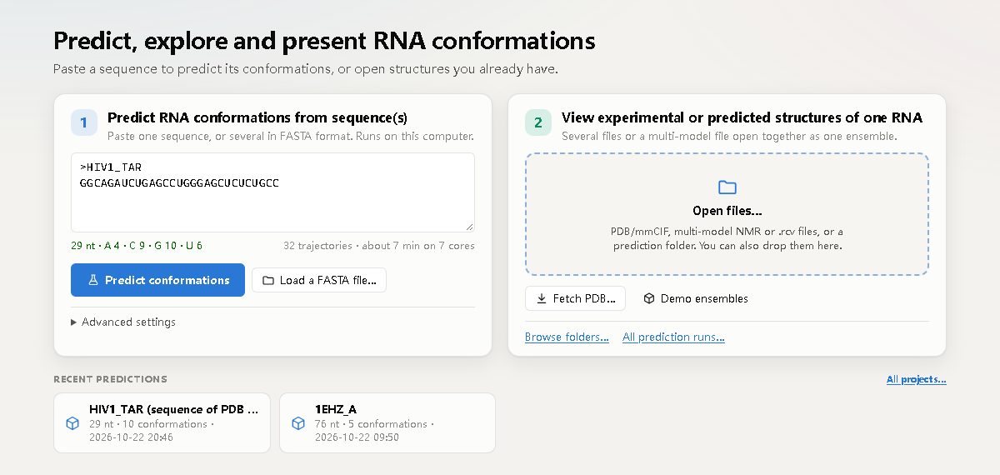
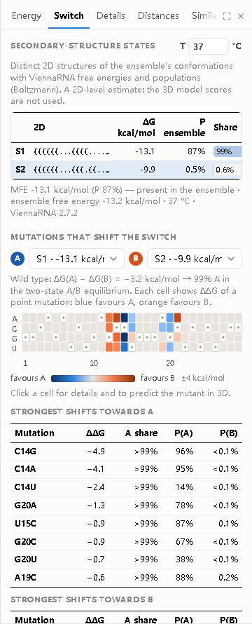
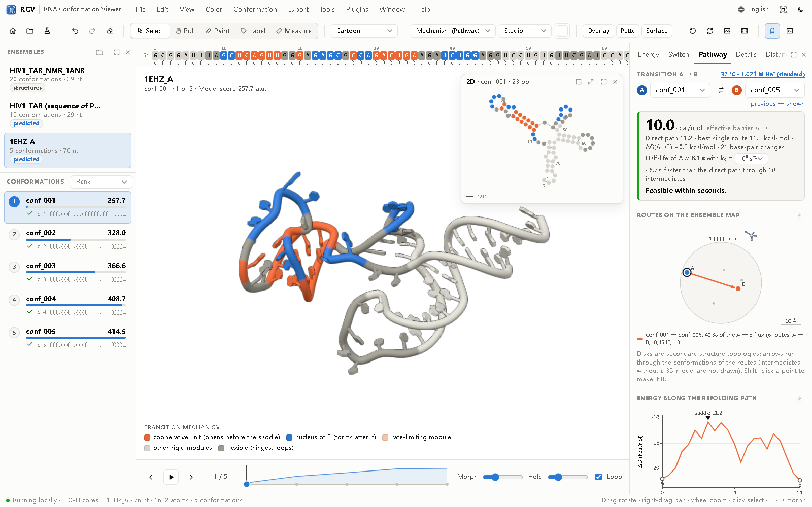
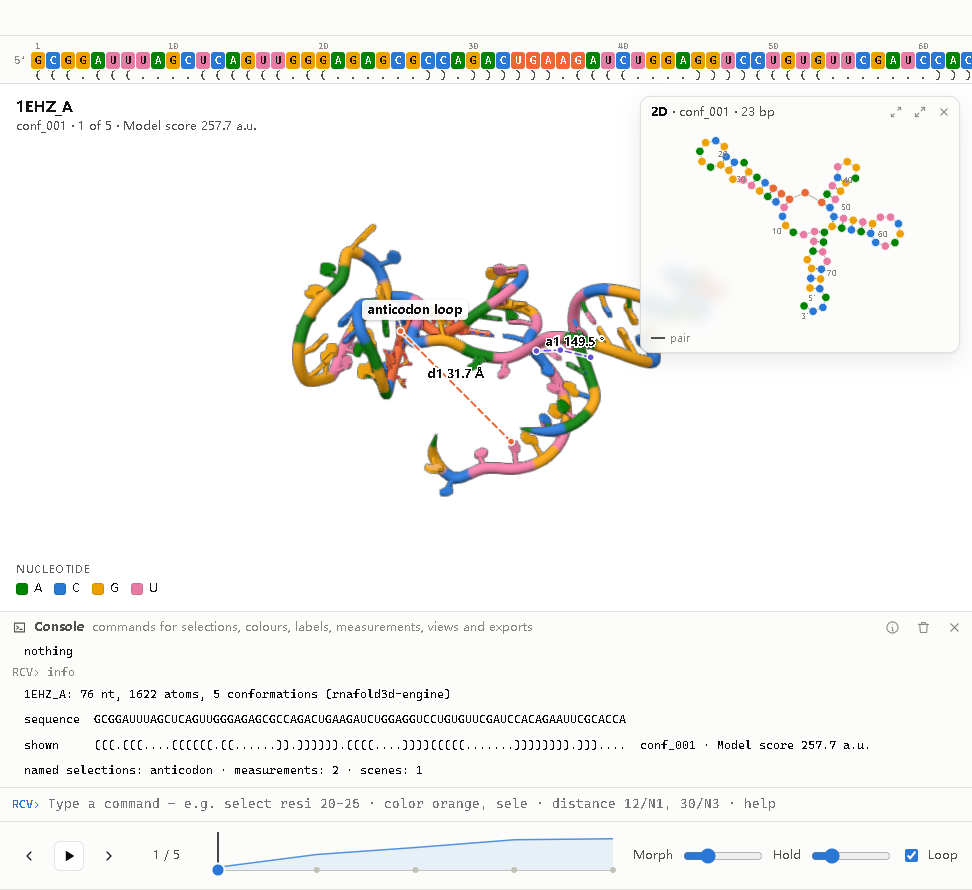
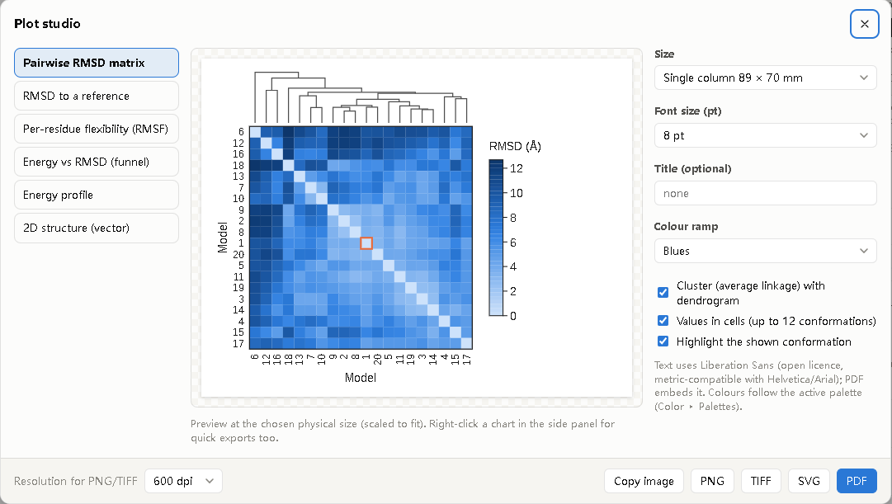
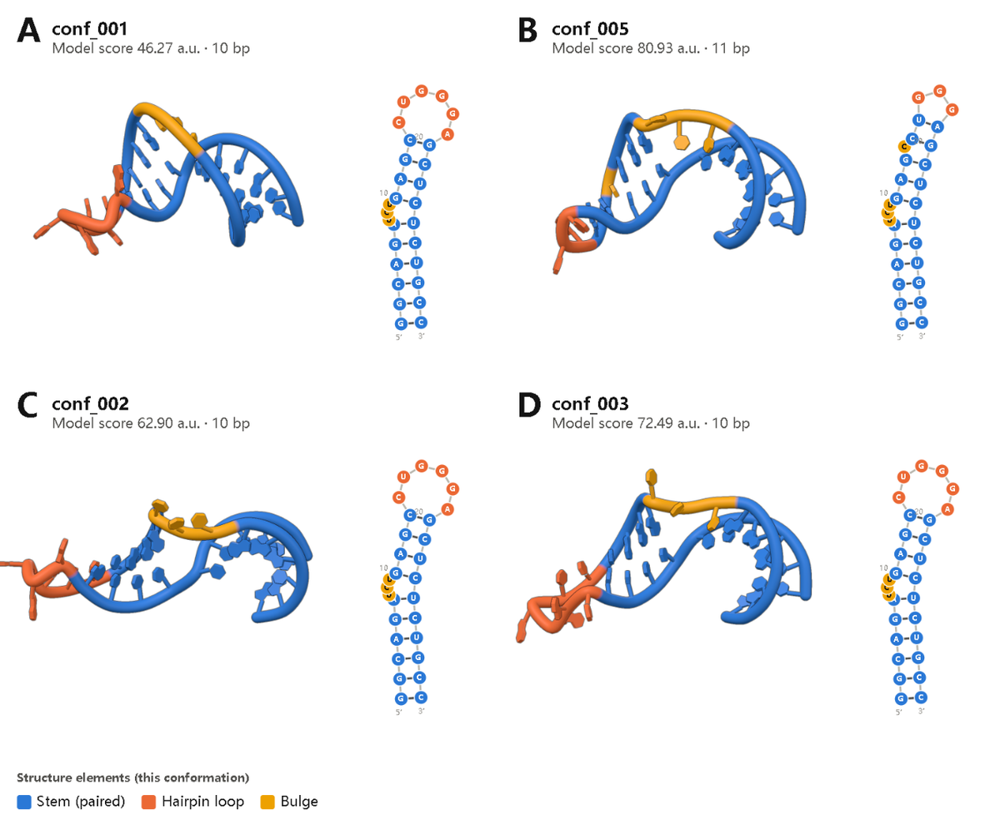
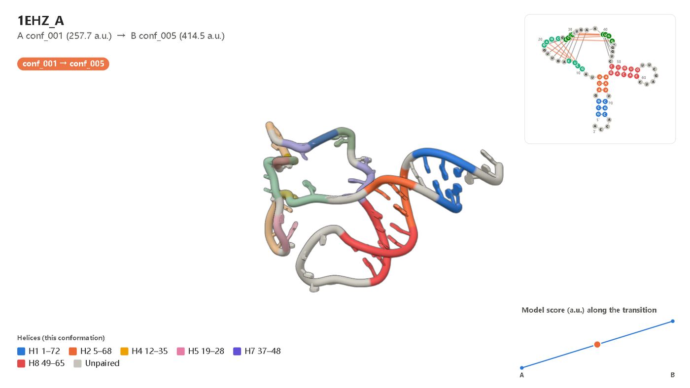

# RCV — RNA Conformation Viewer · user guide


RCV predicts, explores and presents the conformations of an RNA. It combines the rnafold3d prediction engine
(physics-inspired; no deep learning in the prediction) with an interactive viewer in one desktop application: paste
a sequence or a FASTA file, or open your own structures; pull and morph between conformations while the energy and
the 2D structure follow; analyse which mutations shift a switch, **how one conformation turns into another** — the
barrier, the feasible routes, the base pairs and coordinated motions that form the bottleneck, and the mutations
that speed it up or slow it down —, see the whole ensemble on a **topology-aware map**, fit it to **SHAPE or DMS
data**, and read a per-nucleotide **confidence** from a small optional neural network; then share the result as one
`.rcv` file, publication figures, videos or an interactive web page. **Everything runs on your computer**: predictions use your CPU
cores, the 3D view uses your GPU; no data leave the machine (except *Fetch from the PDB*, which downloads an entry
only when you ask for it).

Version 0.7.0, 2026-10-25. Earlier names: RNAconfSwitch (0.4), RNAconformer Viewer (0.3). Free and open-source
software (GPL-3.0). **Author:** Zixiang Wang (princewang2018@gmail.com).


---

## 1. Install and start

**Desktop installers** — download them from **[www.rnaconfviewer.com](https://www.rnaconfviewer.com/#download)**.
They include Python, the engine, ViennaRNA and the demo data (licences of the bundled software:
`THIRD-PARTY-NOTICES.txt`); nothing else needs to be installed.

* **Windows 10/11 (64-bit)** — `RCV-<version>-Windows-x64-Setup.exe`. Setup speaks English, German, Spanish,
  French, Italian, Japanese, Korean, Portuguese or Russian, installs RCV for you or for all users and adds
  Start-menu entries: **RCV**, **RCV with demo ensembles**, **RCV User Guide**, **What is new in RCV** and the
  **Plugin Developer Guide**; a desktop shortcut and opening `.rcv` files with a double-click are options.
  The installer is not code-signed yet, so Windows SmartScreen may warn: choose *More info ▸ Run anyway*.
* **macOS 14 (Sonoma) or later** (Apple Silicon or Intel) — open the `.dmg` and drag RCV to *Applications*; the
  disk image also holds the user guide. The app is not notarised yet: the first time, right-click RCV ▸ *Open*
  (or *System Settings ▸ Privacy & Security ▸ Open Anyway*).
* **Linux (64-bit x86)** — `RCV-<version>-Linux-amd64.deb` for Debian, Ubuntu and Linux Mint
  (`sudo apt install ./RCV-<version>-Linux-amd64.deb`) or `RCV-<version>-Linux-x86_64.rpm` for Fedora,
  RHEL, Rocky, AlmaLinux and openSUSE (`sudo dnf install ./RCV-<version>-Linux-x86_64.rpm`); Ubuntu 20.04,
  Debian 11, Fedora 32, RHEL 9 or newer. They add the `rcv` command and a menu entry (with *RCV with demo
  ensembles* and *RCV User Guide*) and open `.rcv` files. RCV opens in a Chrome, Chromium or Edge app window
  when one is installed, otherwise in your default browser, and quits when that window is closed.
  Remove it with `sudo apt remove rcv` or `sudo dnf remove rcv`.

To build the installers yourself, see `packaging/README.md`.

**From the source folder** (Python ≥ 3.10 with numpy and scipy; ViennaRNA for predictions and the switch
analysis; optional `pip install pywebview` for a native window):

```bash
cd RNAconformer
pip install -e .                 # or: export PYTHONPATH=src
rcv                              # start page
rcv tar.rcv                      # open an .rcv file (with its saved view)
rcv runs/my_rna                  # open an rnafold3d run (keeps engine scores)
rcv models/*.pdb                 # several files of the same RNA, one conformation each
rcv 1ANR.cif                     # multi-model file: one conformation per model
rcv --demo                       # HIV-1 TAR NMR ensemble + two predictions
python -m rcv ...                # same without installing the command
```

Options: `--shell auto|webview|window|browser|none`, `--port 8765`, `--projects-dir DIR` (default
`Documents/RCV/projects`, also in View ▸ Preferences), `--chain B`, `--keep-running`, `--verbose`.

Command-line tools (no window) — the same tools are in the **Tools** menu of the window (section 4):

| Command | What it does |
|---|---|
| `rcv convert PATH… -o x.rcv` | structures, an NMR file or a prediction folder → one `.rcv` file |
| `rcv info x.rcv [--methods]` | sequence, conformations, 2D structures, size, stored methods text |
| `rcv extract x.rcv -o DIR [--multi]` | one PDB per conformation (or one multi-model PDB) |
| `rcv batch seqs.fasta [-o DIR]` | predict every sequence of a FASTA file, one `.rcv` each, plus `batch_summary.csv` |
| `rcv html x.rcv -o page.html` | interactive single-file web page (section 14) |
| `rcv pathway x.rcv --a 1 --b 5 [--scan] [-o r.json]` | transition A → B: barriers, routes, bottleneck, rigid modules, φ values (section 8.1) |
| `rcv probing x.rcv --data r.shape [--dms]` | agreement of every conformation with SHAPE/DMS data, reweighting (section 8.4) |
| `rcv confidence x.rcv` | predicted per-nucleotide accuracy of every conformation (section 8.5) |
| `rcv engine predict …` | the prediction engine itself (same as the `rnafold3d` command) |

| Tools menu | Same as |
|---|---|
| Convert structures to .rcv… | `rcv convert` (choose files or a folder, name the output) |
| Inspect an .rcv file… | `rcv info` (contents, conformations, 2D structures, stored methods text) |
| Extract conformations as PDB… | `rcv extract` (one ZIP of PDB files, or one multi-model PDB) |
| Batch prediction from a FASTA file… | `rcv batch` |
| Fetch a structure from the PDB… | console `fetch` (`Ctrl+Shift+F`) |
| Pathway A → B (barriers, bottleneck, motions) | the Pathway tab, `rcv pathway` (section 8.1) |
| Conditions (temperature, Na⁺, ligand)… | console `conditions` (section 8.3) |
| Load probing data (SHAPE / DMS)… | console `probing`, `rcv probing` (section 8.4) |
| Interactive HTML page · Figure panels · Plot studio | `rcv html` · Export menu |

Settings, logs and plugins live in `%APPDATA%\RCV`, `~/Library/Application Support/RCV` or `~/.local/share/rcv`;
settings, plugins and projects of RNAconfSwitch 0.4 are still found.

## 2. Start page



The start page is one box and four buttons:

* **Paste a sequence** (plain or FASTA; T is read as U) and press **Predict conformations** (or `Ctrl+Enter`).
  The line under the box checks the input as you type and estimates the run time.
  * **Nothing entered?** *Predict* runs the **demo sequence** (HIV-1 TAR, 29 nt) and says so.
  * **Several sequences** (multi-record FASTA; a dot-bracket line after a sequence is used as its known 2D):
    RCV lists them with a check per sequence and offers **Predict N sequences** — a **batch** run, one
    prediction after another, each on all chosen cores (up to 100 sequences).
* **Open files…** — an `.rcv` file, PDB/mmCIF files, a multi-model (NMR) file, a prediction folder or a workspace.
  Files can also be dropped anywhere on the window.
* **Fetch PDB…** — type a 4-character PDB ID (e.g. `1ANR`, `1EHZ`), optionally a chain; RCV downloads the mmCIF
  from the RCSB PDB into `projects/fetched/` and opens it. Nothing is downloaded unless you do this.
* **Demo ensembles** — the HIV-1 TAR NMR ensemble and two predictions.
* **Advanced settings** (closed by default): name, number of conformations to keep, sampling depth (Fast /
  Standard / Thorough = 2 / 4 / 8 trajectories per kept conformation), CPU cores, a known secondary structure
  (dot-bracket), the random seed, *Load a FASTA file…*, *Fill in the demo sequence*, *Browse folders…*, *All
  prediction runs…*.
* **Recent predictions** — the latest runs in the projects folder (including RNAconfSwitch 0.4 runs).

## 3. Prediction progress and batch results

A prediction shows its stages (secondary structures → 3D sampling → validation and selection → opening the
viewer) with live details, a progress bar with the time left, and plain-language **notes** (ViennaRNA
hypotheses and energies, cores used, rejected trajectories and why, conformations kept). *Cancel* stops the
engine. When finished, the viewer opens; the run folder contains PDB + mmCIF + manifest and **`<name>.rcv`**,
which makes reopening it from *Recent predictions* instant.

A **batch** shows one stage per sequence with its current step and an overall time estimate. When it ends, a
results table lists every sequence (conformations, best score, MFE ΔG, number of 2D states, time, status), and
**you choose the prediction to open** (radio button or double-click, then *Open selected in the viewer*). All
others stay in the batch folder as `.rcv` files (with `batch_summary.csv` and `batch.json`) and can be opened
later. A failed sequence does not stop the batch.

Run time grows with length and sampling: on an 8-core laptop a 29-nt hairpin with Standard sampling takes about
5–7 minutes, a 12–14-nt hairpin with Fast sampling 10–60 s.

## 4. The window

| Area | What it does |
|---|---|
| **Menu bar** | File (new prediction, open, save `.rcv`, workspace, **Fetch from the PDB**, PDB/CSV), **Edit** (undo, redo, clear, selection, annotate), View (representation, style, projection, **mouse tool**, overlay, putty, **molecular surface**, **surface and transparency**, 2D window, sequence bar, console, panels, preferences), Color (schemes, background, **palettes**), Conformation, Export (image, figure panels, **plot studio**, video, transition A → B, PDB, CSV, interactive HTML, methods text), **Tools** (section 1), Plugins (manage, **new plugin from template**, plugin folder, **developer guide**), **Window** (show or hide every part, maximise, full screen — section 4.3), Help (**user guide** `F1`, keyboard and mouse, console commands, plugin guide, methods text & citation, demo ensembles, **what is new**, website, about). The **globe button** on the right chooses the interface language |
| **Toolbar** | start page · open · new prediction · **undo · redo · clear** · **mouse tools** (Select, Pull, Paint with its colour, Label, Measure) · representation · colour scheme · style · background · overlay · putty · **surface** · reset · spin · image · video · 2D window · console |
| **Sequence bar** | the sequence coloured like the structure, numbered, with the dot-bracket of the shown conformation underneath; positions whose pairing changed since the previous conformation are underlined. Click, Shift+click or drag to select; hover to highlight in 3D and 2D |
| **Left panel** | ensembles; conformations in the chosen order with value bar, validation mark and 2D. Hover = orange ghost preview, click = morph, **right-click** = transition video, compare, save as PDB |
| **3D view** | drag rotate, right-/Shift-drag pan, wheel zoom, Ctrl-drag roll; the **left button does what the current mouse tool does** (section 4.1); double-click centre, **right-click: residue menu** (select residue, pair, helix or neighbours; sticks, spheres, hide, label, colour; zoom; measure from here — applied to the whole selection when you click inside it); title, legend, morph badge, annotations, **2D window** in a corner |
| **Console** | the command line (section 9), below the 3D view (`` ` ``) |
| **Timeline** | previous / play / next, scrubber with energy sparkline (drag to morph continuously), morph and hold times, loop |
| **Right panel** | **Energy**, **Switch** (section 7), **Pathway** (section 8.1), **Details** (selection, named selections & scenes, measurements, probing data, conformation facts, all metrics, all conformations, provenance), plugin tabs |

The Energy tab: metric selector, hero value with the change versus the previous conformation, energy profile and
landscape (funnel, topology-aware ensemble map — section 8.2 — or classical MDS) whose marker follows every morph, the additive energy terms and the two-sided
base-pair arc diagram. Measurements appear as their own metric group. The charts are drawn like journal figures
(axis lines with ticks, rotated axis titles with units, open-licence figure font); each has an **export button**
(PDF, SVG, PNG, TIFF, copy), and right-clicking any chart offers the same. Tables use a three-rule (booktabs)
layout; right-click a table to copy it as tab- or comma-separated text.

### 4.1 Mouse tools, annotations, undo

The left mouse button works like in a drawing program. Choose the tool in the toolbar or with one key:

| Tool | Key | Left button in the 3D view |
|---|---|---|
| **Select** | `V` | click selects a residue (Shift adds), drag rotates |
| **Pull** | `G` (or hold `Alt`) | drag a residue to switch conformation (section 6) |
| **Paint** | `B` | click or drag over residues to give them the paint colour (chip next to the tool: palette colours or any colour; residues or single atoms) |
| **Label** | `T` | click a residue to label it; drag labels to move them; double-click or right-click a label to edit text, colour, size, arrow and box; `Delete` removes the selected label |
| **Measure** | `M` | click two atoms for a distance |

**Annotations** are residue labels, region labels (a bracket over a selection, e.g. "anticodon stem") and free
notes or titles placed on the view (Edit ▸ Add a title / note). They follow the structure during morphs and are
included in images, figure panels and videos, and saved in `.rcv` files.

**Undo / redo** (`Ctrl+Z`, `Ctrl+Y` or `Ctrl+Shift+Z`, toolbar arrows, Edit menu) step back and forward through
the edits of the open ensemble: annotations, paint strokes and custom colours, labels, hidden residues and
per-residue representations, measurements, selection, colour scheme, representation, style, background, overlay,
putty, surface and transparency — including changes made with console commands. Each ensemble has its own
history. **Clear** (toolbar eraser, Edit menu) removes one kind at a time — custom colours, display changes,
residue labels, annotations, measurements, selection — or everything at once; clearing can be undone too.

### 4.2 It behaves like a desktop program

The RCV window is a desktop program, not a web page: text cannot be selected by accident (except in text fields
and the console), images cannot be dragged away, and the right mouse button shows RCV's own menus (residue menu
in 3D, export menu on charts, copy menu on tables, cut/copy/paste in text fields) instead of the browser's.
Browser shortcuts are replaced: `Ctrl+F` selects residues, `Ctrl+P` exports an image, `Ctrl` + wheel and
`Ctrl++ / Ctrl+− / Ctrl+0` zoom the 3D view instead of the page; reload, back/forward, view-source and
middle-click auto-scroll are blocked. The window has its own RCV profile (taskbar icon, settings), separate from
your Edge/Chrome profile. Plugin developers can turn on **Developer mode** (View ▸ Preferences) to get the
browser's developer tools back (F12, Shift+right-click).

### 4.3 Language and window layout

**Interface language.** RCV speaks English, 简体中文, 繁體中文, 日本語, 한국어, Español, Français, Deutsch,
Italiano, Português (Brasil) and Русский. Choose the language with the **globe button** (menu bar, and the top
of the start page) or in View ▸ Preferences; the switch is immediate and remembered. Until you choose, RCV
follows the language of your system. Menus, buttons, dialogs, panels, tooltips, messages and the job notes are
translated. Kept in English on purpose, so that results look the same everywhere: figures and charts (and
therefore every exported image, PDF, video and plot), the command console and its commands, the methods text
for manuscripts, and structure data (residue and file names).

**Window layout** (Window menu). Every part of the window can be shown or hidden: the ensembles panel, the
analysis panel, the 2D structure window, the console, the sequence bar, the toolbar, the playback bar, the status
bar, and the title and legend on the 3D view. Hidden panels also have a × in their title bar; the Window menu
shows them again (*Show all panels*). The side panels, the 2D window and the console can be **maximised** to
fill the window — with the button in their title bar, by double-clicking the title bar or from the Window menu —
and `Esc` restores them. `H` hides everything around the 3D view (press again to bring it back), `F11` switches
to full screen, and *Reset window layout* returns to the original arrangement. The layout is remembered between
sessions.

## 5. The 2D structure window

A small window in a corner of the 3D view (`D`, View ▸ 2D structure window) draws the secondary structure of the
shown conformation — ViennaRNA NAView layouts computed when the ensemble is opened (a built-in radial layout
otherwise), 5′/3′ ends at the bottom, tall hairpins turned sideways — with:

* nucleotides **coloured exactly like the 3D structure** (any scheme, custom colours included);
* **linked highlighting**: hover a nucleotide in 2D to highlight it in 3D and in the sequence bar, and the other
  way round; click selects (Shift adds), double-click centres the 3D view on it;
* **switching in step with 3D**: when the conformation changes, the drawing morphs to the new structure as the
  3D model morphs; pairs that break fade out during the first half, new pairs fade in during the second half,
  and new pairs (versus the previous conformation) stay orange; pseudoknotted pairs are purple arcs;
* buttons to move it to another corner and to switch between small, medium and large.

The same drawing is used in transition videos, figure panels and the interactive HTML page.

## 6. Pull to switch

Switch on the **Pull** tool (`G`) — or hold `Alt` — and drag a residue: the structure stretches elastically,
the conformation that best reproduces the pull is previewed as an orange ghost with its energy change, and on
release the structure morphs to it (the most stable one among about equally good matches — relatively stable,
not necessarily the lowest). **Explore new conformations** runs the engine with the pull as a temporary bias,
then relaxes the models without it and adds them to the ensemble. In tests on TAR the chosen conformation put
the dragged residue 2.3–3.2 Å from the cursor (screen plane) versus about 6 Å for staying put.

## 7. Switch analysis (Switch tab)



For RNA switches the question is often *which state dominates, and what would change that?* The Switch tab
answers it at the secondary-structure level with ViennaRNA (Turner 2004 energies):

* **2D states** — the distinct secondary structures of the ensemble's conformations (the engine's hypothesis,
  or the canonical nested pairs annotated in 3D), each with its free energy, its probability in the full
  ViennaRNA ensemble, its **share of the population among these states** (Boltzmann) and the number of models
  (click to step through them). The temperature can be changed (0–95 °C), e.g. to look at thermo-switches.
  The MFE and the ensemble free energy are shown for reference.
* **Mutations that shift the switch** — choose states **A** and **B**: every possible point mutation is
  evaluated (3 × length mutants) and shown as a heat map of ΔΔG = ΔG(A) − ΔG(B) of the mutant minus that of the
  wild type: **blue favours A, orange favours B** (diverging scale with a neutral midpoint, saturating at
  ±4 kcal/mol). A mutation that turns a pair into a non-canonical one removes that pair from the state.
  Hover a cell for the shift of the two-state A/B equilibrium; the tables list the strongest shifts in each
  direction with the full-ensemble probabilities of A and B in the mutant (other structures can dominate).
* **Act on it** — click a cell to select the residue in 3D, copy the mutant as FASTA, or **Predict in 3D**
  (opens the start page with the mutant ready to predict). *Colour 3D by mutation sensitivity* colours every
  residue by the largest |ΔΔG| at its position; *Copy scan as table* gives all mutations as tab-separated text.

* **Conditions** — the link under the title opens the Conditions dialog (section 8.3): temperature, Na⁺, a ligand
  that binds an aptamer, and probing data as pseudo-energies. With a ligand, the **ligand response** chart shows the
  share of every state from 1 nM to 1 mM and the half-way concentration of the states that bind.

These are 2D-level estimates; the 3D model scores are not used, and populations are not experimental.

## 8. Transitions, ensemble map, probing data and confidence



### 8.1 Pathway tab: how A turns into B

Choose two conformations A and B in the Pathway tab (or *previous → shown*, or Shift+click a point of the map).
RCV answers three questions.

**Is the switch feasible, and along which route?** At the secondary-structure level (ViennaRNA Turner energies under
the conditions of section 8.3) RCV first lets A and B relax into their **basins** — the local minima they reach by
steepest descent. A structure that is not itself a minimum (a frayed NMR model, a model with a strained pair) slides
into its basin before anything else happens, so barriers and rates are measured **between the basins**, as in
barrier-tree analyses. If A and B reach the same basin, no barrier separates them: the verdict says so and shows how
far each lies above the shared minimum (they are fluctuations of one fold, not separate states). Otherwise RCV
computes the direct refolding path (*findpath*: only pairs of A open and only pairs of B form) and routes through
intermediates — the basins of the ensemble's other 2D states and local minima reached by gradient descent from
Boltzmann-sampled structures (fixed seed: the same result every time). The basins and the saddles between them
form a network with Arrhenius rates k = k₀·exp(−(saddle − E)/RT) (k₀ adjustable, default 10⁶ s⁻¹): **transition
path theory** gives committors, the reactive flux and the routes ranked by flux, and the **time to switch** is the
mean first-passage time (MFPT) from the basin of A to the basin of B. The verdict card shows the effective barrier
(RT·ln(k₀·MFPT)), the barriers of the direct path between the structures A and B and of the best single route
between the basins, ΔG(A→B), the half-life of A and a plain-language feasibility statement; a **trap** note
appears when wells deeper than the basin of A — on the A side, or on the way to B — hold the RNA for most of the
switching time (the expected time spent in every node before B is reached comes with the MFPT) and make the switch
at least twice as slow as crossing the best single route. The map shows the routes through 3D conformations (2D-only intermediates are
listed, not drawn); the energy profile shows every base-pair move — the relaxation into the basins (dotted), the
route (solid), the direct path (dashed) and the saddle. Hover a step to see the structure and the pairs that open
or form, highlighted in 3D.

**Which coordinated motions are the bottleneck?** The **cooperative unit** is the set of base pairs that must open
together on the climb to the highest saddle; the **nucleus** is the set of B pairs that form right after it. In 3D
RCV splits the molecule into **rigid modules** — groups seeded by the helices that A and B share, merged while they
still move as one body (fit within 2 Å) — and reports each module's turn (degrees), shift (Å) and screw axis
relative to the largest module, and the time window of its base-pair events along the route; **hinges** are the
flexible residues with the largest backbone change. The module that carries the cooperative unit is named the
**rate-limiting coordinated motion**. *Colour by mechanism*, *by event order* or *by module* paints the view;
**Play the mechanism** morphs A into B with the modules turning in the order of their events (each module keeps its
shape and a distance-geometry refinement keeps the chain connected — an illustration of the analysed mechanism, not
a simulation; *Rigid-module morph* moves all modules together); *Mechanism video…* records it (section 14).

**Which mutations change the switching rate?** The **φ-value scan** evaluates all 3 × length point mutations along
the route: ΔΔG‡ (change of the barrier: blue = faster switching, orange = slower), ΔΔG (change of the A/B balance)
and φ = ΔΔG‡/ΔΔG where |ΔΔG| ≥ 0.6 kcal/mol — φ near 1 where the nucleotide already looks as in B at the saddle
(its A pairs open or its B pairs formed), near 0 where it still looks as in A. The lists name the mutations that
speed the switch up or slow it down most, with the factor on the rate; *Colour 3D by kinetic sensitivity* and
*Copy scan as table* work as in the Switch tab.

Console: `pathway A, B` · `phiscan` · `mechanism [staged|rigid]`. Command line:
`rcv pathway x.rcv --a conf_001 --b conf_005 --scan -o result.json`.

### 8.2 Ensemble map

The **Map** view of the Energy tab (also in the Pathway tab, the plot studio and the HTML page) places
conformations so that map distances follow their C4′ RMSD **under a topology constraint**: every
secondary-structure topology — the abstract shape of its 2D structure, helix nesting only (`[]` one hairpin,
`[][]` two hairpins, `[[][]]` a multibranch helix) — has its own disk that no other topology enters, labelled
T1, T2, … with a small drawing of its 2D structure. Disks are arranged by 3D similarity and linked when the
topologies differ by one helix; inside a disk conformations are placed by RMSD and 2D states stay together. The
caption reports how well neighbourhoods are kept (trustworthiness and continuity; Venna & Kaski 2001) and the
topology purity of map neighbours, for this map and for classical MDS (still available as *MDS*). See
`docs/V07_VALIDATION.md` for a comparison.

### 8.3 Conditions: temperature, salt and ligands

The **Conditions** dialog (Tools menu, or the conditions link in the Switch and Pathway tabs) sets the temperature,
the **Na⁺ concentration** (ViennaRNA salt correction; 1021 mM is the standard state of the Turner parameters) and a
**ligand** that binds an aptamer forming a hairpin or interior loop (motif soft constraint; preset: theophylline
aptamer, Kd 0.32 µM; or your own motif and Kd). Every structure that forms the motif gains −RT ln(1 + c/Kd)
(two-state binding, ligand in excess). Conditions are kept per ensemble, saved in `.rcv` files and used by the
Switch and Pathway tabs. Console: `conditions 25, 150 mM, theophylline 10 µM` · `conditions standard`.

### 8.4 Probing data (SHAPE, DMS)

Tools ▸ **Load probing data** reads a reactivity profile — position and value (RNAstructure `.shape` and most lab
formats), ShapeMapper `.map`, CSV with a *reactivity* column, or one value per line; −999 and NaN mean no data —
and normalises it by the 2–8 % rule unless you switch that off (DMS: A and C only). RCV then

* colours the structure by reactivity (scheme *Reactivity*), and the Details tab shows the profile under the
  pairing of the shown conformation;
* scores every conformation: the area under the ROC curve of reactivity as a predictor of unpaired nucleotides
  (metric *SHAPE agreement (AUC)*);
* reweights the ensemble by maximum entropy to fit the data (metric *SHAPE data weight*; θ sets how far the data may
  move the weights; χ² before and after and the effective number of conformations are reported);
* optionally uses the reactivities as pseudo-energies for the 2D-state populations (Deigan et al. 2009; Conditions
  dialog). These are data-informed estimates, not free energies.

The profile, the fit and the weights are saved in `.rcv` files. Console: `probing file.shape, SHAPE` ·
`probing clear`. Command line: `rcv probing x.rcv --data file.shape [--dms]`.

### 8.5 Confidence model (optional)

When an ensemble opens, RCV predicts the **local accuracy of every nucleotide** of every conformation — the lDDT it
would have against the true structure — with a small neural network that runs on the local engine in the
background: two dense layers, about 3,200 parameters, numpy only, a fraction of a second per ensemble on a laptop;
no GPU, nothing to download. It reads only the coordinates (41 features per nucleotide: identity, pairing,
stacking, backbone pseudo-torsions, sugar pucker, glycosidic torsion, packing, clashes, chain breaks, and their
averages over the spatial neighbourhood). It is not part of the prediction engine and never changes a structure; it
only scores. RCV then shows

* the metric **Confidence (predicted lDDT)** — the mean over the nucleotides, higher is better — in the Energy tab,
  the conformation list, the plot studio and the HTML page;
* the colour scheme **Confidence (per nucleotide)** in four bands: high (≥ 0.8), medium, low, very low (< 0.5).

Switch it off in View ▸ Preferences. Command line: `rcv confidence x.rcv -o confidence.json`.

The model was trained on engine models of 132 RNA chains from the BGSU non-redundant set (4 Å) that are kept apart
from the benchmark — no shared equivalence class, below 80 % sequence identity, no benchmark family named in the
entry title — (1,121 models and the native structures; labels: per-nucleotide all-atom lDDT). Cross-validated per-nucleotide correlation r = 0.82; on the benchmark, never
seen in training, r = 0.75 (test split) and 0.84 (dev split), and native structures score 0.86 on average against
0.49 for engine models. Picking the top model by confidence is not reliably better than the engine's own ranking
(better on the test split, worse on the dev split), so the engine's ranking is kept and confidence is shown as an
additional guide to which parts of a model to trust. Details: `docs/V07_VALIDATION.md`; retraining:
`tools/qa_model/`.

## 9. Command console



Open it with `` ` `` or the terminal button. One command per line, arguments separated by commas; `↑/↓`
history, `Tab` completes commands, keywords, names and conformation ids; pasting several lines runs them as a
script; `help` and `help <command>` explain everything. RCV's command language is its own; its verbs follow the
common vocabulary of molecular viewers, so users of other programs feel at home.

**Selection language** (residue level; combine with `and`, `or`, `not`, parentheses):

| Selection | Meaning |
|---|---|
| `all`, `none`, `sele` | everything, nothing, the current interactive selection |
| `resi 5-12+20` · `pos 1-10` | author residue numbers · sequence positions (`12-18` alone = positions) |
| `resn A+G` · `A`, `C`, `G`, `U` · `chain A` | nucleotide type · chain |
| `paired`, `unpaired`, `pk` | base-paired / unpaired / pseudoknotted in the shown conformation |
| `helix H2` | residues of a helix family |
| `switching` · `changed` | pairing partner differs between conformations · between previous and shown |
| `rmsf > 3` · `moved > 2` | flexibility across the ensemble · displacement since the previous conformation (Å) |
| `within 6 of resi 20` | residues with an atom within 6 Å (shown coordinates) |
| `name P` · `first`, `last` · `<name>` | residues having an atom · ends · a named selection |

Atoms (measurements) are written `residue/atom`, e.g. `34/N1`, `12/C4'`, `pos 5/P`.

**Commands** (aliases in parentheses):

| Command | Example |
|---|---|
| `select [name,] selection` (`sel`) · `deselect` · `count` | `select loop, resi 23-27 and unpaired` |
| `show` / `hide what[, selection]` — cartoon, sticks, spheres, ballstick, labels, everything, ensemble, putty, 2d, sequence | `show sticks, switching` · `hide cartoon, resi 1-3` |
| `rep`, `style`, `projection` | `rep cartoon+atoms` · `style illustrative` |
| `color colour or scheme[, selection]` (`colour`) · `bg colour` | `color orange, loop` · `color elements` · `color default, all` |
| `label selection[, text]` · `label off` | `label resi 34, anticodon` |
| `zoom`, `center`, `orient [selection]` · `reset` · `turn x\|y\|z, deg` · `spin on\|off` | `orient helix H2` · `turn y, 90` |
| `conf id\|number\|first\|last\|previous` (`goto`) · `next`, `prev`, `play`, `stop` · `morph a, b[, s]` · `order`, `metric` | `morph conf_001, conf_005, 2` |
| `distance [name,] a, b` (`dist`) · `angle` · `dihedral` (`torsion`) · `measurements [clear]` | `distance d1, 22/N1, 27/N3` |
| `align a, b[, sel]` (`super`) · `rms a, b[, sel]` · `fit selection\|reset` · `pairs [conf]` · `info` | `align 1, 4, helix H1` |
| `view save name` · `view name` · `view list` · `view delete name` (`scene`) | `view save closeup` |
| `ls` · `delete name` · `set setting, value` | `set morph, 2` · `set labels, every10` |
| `png [w[, h[, dpi]]]` · `save rcv\|pdb\|pdb all\|csv\|workspace` · `video transition a, b` | `png 3000, 2000, 600` |
| `load path` · `fetch PDBID[, chain]` · `run script.rcvs` (`@`) · `echo text` | `fetch 1ANR` |
| `pathway A, B` (`transition`) · `phiscan` · `mechanism [staged\|rigid]` | `pathway conf_001, conf_005` |
| `conditions [°C][, Na mM][, ligand µM \| no ligand \| standard]` (`cond`) · `probing path[, SHAPE\|DMS] \| clear` | `conditions 25, 150 mM, theophylline 10 µM` |

`fetch` downloads mmCIF from the RCSB PDB (internet needed) into `projects/fetched/`. Scripts are text files
(`.rcvs`, `.cmd` or `.txt`) with one command per line (`#` comments); `examples/scripts/tar_switch_figure.rcvs` is an example. Every command run on an ensemble is kept
with it and saved in its `.rcv` file — the *Methods text* dialog shows it as a reproducible figure recipe.

## 10. Measurements, named selections and scenes

* **Measure** (`M`, ruler button): click two atoms for a distance; the console adds angles and dihedrals.
  Measurements are drawn as dashed lines with live values that **follow every morph**, and each one is a
  metric, so its value per conformation can be plotted in the energy panel and exported with the CSV table.
* **Named selections** (console `select name, …` or *+ Selection* in Details) are chips you can click to
  reselect, zoom to or delete; any command accepts them by name.
* **Scenes** (`view save name`, *+ Scene*) remember camera, conformation, colours, representation, overlay,
  putty and selection; recalling one flies the camera there and morphs to its conformation.

All of these, plus custom colours, labels and hidden or highlighted residues, are saved in `.rcv` files.

## 11. Files: .rcv, structures, workspaces

* **`.rcv` (File ▸ Save as .rcv, `Ctrl+S`)** — one file per RNA with *all* its conformations and everything
  RCV knows about them. Typically **10–14× smaller than the same models as PDB** (e.g. 20-model TAR NMR
  ensemble: 77 kB vs 1.0 MB), while also containing energies, 2D structures and layouts, validation reports,
  provenance and your view. Opening it is instant (no re-evaluation).
* **Structures**: PDB, mmCIF, multi-model files, rnafold3d run folders. All conformations must be the same RNA
  (matched by position when the sequences are identical, else by author numbering).
* **Workspace** (`Ctrl+Shift+S`): every open ensemble in one JSON file (larger; opens without the engine).
  RNAconfSwitch sessions (`.rnaconf.json`) and older `.rnaview.json` files still open.

### The .rcv format (`rcv/1`)

An `.rcv` file is a ZIP archive — rename it to `.zip` to look inside:

| Entry | Content |
|---|---|
| `mimetype` | `application/vnd.rcv+zip` (first entry, stored) |
| `rcv.json` | manifest (format, app version, sequence, counts, coordinate encoding and SHA-256) and the ensemble document without coordinates: residues, atom names, per-conformation pairs, dot-brackets, energies and terms, validation, helix families, RMSD matrix, similarity map, RMSF, 2D layouts, provenance (engine version, parameters, seeds, source-file checksums), warnings |
| `coords.bin` | coordinates as `rcv-coords/1`: int32 little-endian milli-ångström values per conformation in three planes (x, y, z); conformation 0 stored as differences along the atom order, the others as differences to conformation 0; byte-shuffled; deflated by ZIP. Precision 0.001 Å (as PDB) |
| `bonds.bin` | covalent bonds, uint32 atom-index pairs |
| `session.json` | the view: camera, representation, style, colours, metric, order, conformation, selection, named selections, custom colours/labels, hidden residues, measurements, annotations, scenes, command log, plugin state (e.g. Distance tracker distances) |
| `thumbnail.jpg` | preview image |
| `methods.txt` | methods paragraph (section 14) |
| `provenance/manifest.json` | the engine's own manifest, verbatim |
| `README.txt` | this description |

`rcv extract` turns it back into PDB files; `rcv info` summarises it; damaged files are detected by the checksum.

## 12. Energies and metrics

**Engine scores** (rnafold3d predictions; dimensionless, kT-like): *Model score* = 3D score + 2D offset,
decomposed into clash, chain closure, restraints, loop feasibility, compaction, helix stacking, hairpin geometry,
electrostatics, torsion prior, loop torsions and the 2D offset; *ΔG of input 2D* (ViennaRNA). Scores rank models;
they are not free energies and ranks are not populations.

**Evaluator energy** (every source, kcal/mol-scaled): ΔG 2D (Turner, ViennaRNA) of the annotated nested
canonical pairs + Debye–Hückel electrostatics + loop/tertiary stacking (−1 per non-helical stack) + steric
clashes (+1 per severe clash). A transparent heuristic for comparing conformations of one sequence.

**Descriptors**: base pairs, pseudoknotted pairs, stacks, radius of gyration, overlaps per 1000 atoms, C4′ RMSD
to the first conformation and to the mean. **Measurements** and **plugins** add metrics. **RMSF** drives the
flexibility colours and putty. **Morphs** are interpolations between superposed conformations — a visual aid,
not a simulated pathway (the mechanism morph of section 8.1 follows the analysed order of events, still without
simulating it).

**Confidence (predicted lDDT)** — mean predicted local accuracy from the optional confidence model (section 8.5).
**SHAPE/DMS agreement (AUC)** and **data weight** — after loading probing data (section 8.4).

## 13. Representations, colours and styles

* Representations: Cartoon, Cartoon + atoms, Sticks, Ball & stick, Spheres — globally (toolbar `1`–`5`) or per
  residue from the console (`show sticks, …`, `show spheres, …`, `hide cartoon, …`).
* Colour schemes: Nucleotide, Helices, **Structure elements** (stem, hairpin loop, internal loop, bulge,
  multibranch loop, pseudoknot, exterior), Base pairing, **Pairing frequency** (fraction of conformations in
  which a residue is paired), **Switching residues** (partner changes across the ensemble), Flexibility (RMSF),
  Displacement from previous, Position, Nucleotide classic, Uniform, and **Mutation sensitivity** after a
  switch scan. Custom colours from the console go on top of any scheme. Every scheme has a legend.
* Styles: Studio, Illustrative, Glossy, Depth cue, Plain. Backgrounds: white, paper, grey, slate, dark,
  black, custom. Light and dark interface.
* **Palettes** (Color ▸ Palettes and custom colours…): RCV, **Okabe–Ito** and **Tol bright / muted**
  (colour-blind safe), Pastel and **Grayscale** for print, plus your own. The active palette drives helix,
  structure-element and nucleotide colours, the paint tool, annotations, measurements and the plot studio, so a
  whole figure changes with one click. *Duplicate to edit* makes an editable copy (4–12 categorical colours and
  the A/C/G/U colours); palettes can be copied and pasted as JSON to share them. A **colour-vision check**
  simulates deuteranopia, protanopia and tritanopia and names the closest pair of colours (ΔE in OKLab), so
  you see which colours colour-blind readers may confuse.
* **Molecular surface** (`U`, toolbar, View menu, console `show surface[, selection]`): a smooth Gaussian surface
  computed on your computer (a 76-nt tRNA in about 0.15 s), coloured like the residues under it — any scheme,
  palette and paint colour — and recomputed during morphs and in videos. It can cover the whole RNA or only the
  selection.
* **Transparency per object** (View ▸ Surface and transparency…, console `set transparency, 0.5, surface`):
  separate opacity for cartoon, bases, atoms, surface and the ensemble overlay — for example a 40 % surface over
  an opaque cartoon.

## 14. Publication output

* **Image** (`Ctrl+E`): PNG/TIFF/PDF at journal sizes and 300–1200 dpi, transparent background, legend, labels,
  annotations, measurements and the energy panel (vector in PDF).
* **Figure font**: all figure text (images, panels, plots, videos) uses **Liberation Sans**, bundled with RCV
  under the SIL Open Font License 1.1 (free to use and embed; same letter widths as the common Helvetica/Arial
  style that journals ask for). PDF files embed the font (subset), so they look the same on every computer.
* **Plot studio** (Export ▸ Plot studio, Tools menu, or the export button of a chart): publication plots of the
  ensemble at journal sizes in millimetres (single column 89 mm, 1.5 column 120 mm, double column 183 mm, or
  custom), font size in points, optional title and axis labels, PDF/SVG (vector), PNG/TIFF at 300–1200 dpi, or
  copy:
  * **Pairwise RMSD matrix** — C4′ RMSD heat map with a colour bar in Å, optional average-linkage clustering
    with a dendrogram, values in the cells (up to 12 conformations), single-hue ramps (Blues, Grays for print, …);
  * **RMSD to a reference** — first, best by energy, shown, previous or the ensemble mean structure;
  * **Per-residue flexibility (RMSF)** — with a pairing track under the axis and, optionally, the displacement
    since the previous conformation;
  * **Energy vs RMSD (funnel)** — points coloured by 2D state; **energy profile** (line or bars); **2D structure**
    as a vector drawing;
  * **Ensemble map (topology-aware)** — disks per topology with their 2D drawings, points coloured by any metric
    with a colour bar, optionally the A → B routes of the Pathway tab;
  * **Refolding path A → B** — free energy along the best route (and the direct path), route nodes and the saddle;
  * **φ-value scan** — ΔΔG‡ of every point mutation as a heat map with the φ value per position.

  

* **Figure panels** (Export ▸ Figure panels): several conformations in the **same orientation**, lettered
  A, B, C…, each with its name, energy, base-pair count and its **2D structure beside it**, with one shared
  legend; single/1.5/double column width, square, 4:3 or portrait panels, 300/600 dpi, PNG/TIFF/PDF. Presets:
  one panel per 2D state, first four, previous + current.

  

* **Video**: conformation tour, rotation, rock, tour + rotation, and **Transition A → B**: hold on A, morph to B
  directly or **through intermediates** (the ensemble conformations on the lowest-RMSD route, leg durations
  proportional to RMSD) or as the **mechanism** of the Pathway tab (rigid modules turning in the order of their
  base-pair events), hold on B, optionally back to A, with an optional slow turn. The overlay names A and B
  with their energies, shows a chip for the current leg and plots the metric **along the route** with a moving
  marker; the **2D inset morphs with the structure**. MP4, WebM or lossless PNG frames; 720p to 4K. Right-click
  a conformation for *Transition video current → this*.

  

* **Interactive HTML** (Export ▸ Interactive HTML page, or `rcv html`): one self-contained file (~1.3 MB) that
  opens in any current browser without installation or internet — for supplementary material, reviewers and
  collaborators. It shows the 3D structure (rotate, zoom), the conformation list with energies, play and
  morph, representation and colour choices, the energy profile, the 2D structure (morphing too), the
  **ensemble map** (click to morph), the **pathway** of the Pathway tab when it was computed (verdict, refolding
  path, bottleneck, φ-value scan and *Play the mechanism*), the sequence and the methods text.
* **Methods text & citation** (Export or Help menu): a methods paragraph built from what the ensemble records
  (engine and ViennaRNA versions, sampling, seeds, validation, clustering, superposition, RMSD range, what the
  energies mean) — extended by paragraphs on the pathway analysis, the φ-value scan, the ensemble map, probing
  data and the confidence model when they were used, with exact settings and a list of **references** to cite —,
  a software citation, and the command log as a reproducible recipe. Check it against your protocol before use.
* Also: quick PNG (`S`), PDB of one or all conformations, energy table CSV, `.rcv`.

## 15. Keyboard and mouse

Tools: `V` select · `G` pull (`Alt`+drag) · `B` paint · `T` label · `M` measure · `Delete` remove the selected label.
View: `U` surface · `D` 2D window · `` ` `` console · `1–5` representations · `C` colour scheme · `E` overlay ·
`P` putty · `L` labels · `F` centre on selection · `R` reset · `A` auto-rotate · `S` snapshot · `Ctrl++ / Ctrl+− /
Ctrl+0` zoom. Conformations: `←/→` previous/next · `Home/End` · `Space` play. Edit: `Ctrl+Z` undo · `Ctrl+Y` redo
· `Ctrl+A` select all · `Ctrl+F` select (console) · `Esc` cancel / clear. Files: `Ctrl+N` new prediction ·
`Ctrl+H` start page · `Ctrl+O` open · `Ctrl+Shift+F` fetch from the PDB · `Ctrl+S` save .rcv · `Ctrl+Shift+S`
workspace · `Ctrl+E` / `Ctrl+P` export image · `F1` user guide · `?` keyboard and mouse. Window: `H` only the 3D
view · `F11` full screen · `Esc` restore a maximised panel. Mouse: drag rotate, right-drag pan, wheel zoom, Ctrl-drag
roll, left button = current tool, double-click centre, right-click residue menu.

## 16. Plugins

Interface plugins (`*.js` ES modules with `activate(api)`) and analysis plugins (`*.py` with `PLUGIN` and
`compute(sequence, residues)`) are loaded from the `plugins` folder of the user data folder (section 1).
**Plugins ▸ New plugin from template…** writes a working, commented template; **Plugins ▸ Plugin developer
guide** shows the full guide inside RCV (also in [`docs/PLUGINS.md`](PLUGINS.md)). Plugin API version 2 adds
console commands, annotations, the active palette, surface/transparency/colour control and chart export to
version 1 (state, events, navigation, panels, menu items, overlays, colour schemes, metrics); version 3 (0.6.1)
adds per-ensemble metrics, removing metrics and plugin state saved in `.rcv` files with undo/redo. Earlier
versions keep working. Plugins can also listen to the events `pathway` (a finished Pathway analysis),
`conditions` and `probing`. Built-in examples: Distance tracker (its distances are saved in `.rcv` files and can be
undone) and Similarity matrix; Python example
`examples/viewer_plugins/tertiary_contacts.py`. Plugins run with your user rights — install only plugins you trust.

## 17. How it works on your computer

```
RCV window (pywebview / Edge-Chrome app window; WebGL 2 on the GPU)
   │  ES modules + three.js r160 (MIT): viewer, surface, panels, 2D window, console, switch tab, plots, exports
   │  JSON over http://127.0.0.1 (loopback only, per-session token, Host check, strict CSP)
rcv (Python standard-library server)                       src/rcv/
   ├─ data.py        structures → ensemble documents (rcv.document/1), 2D layouts
   ├─ rcvfile.py     the .rcv format (pack / unpack / PDB)
   ├─ jobs.py        prediction, batch and pull-exploration jobs (engine child processes on the CPU cores)
   ├─ switch.py      2D-state populations, mutation scan and ligand response (ViennaRNA)
   ├─ conditions.py  temperature, Na⁺, ligand (aptamer motif) and probing pseudo-energies for ViennaRNA
   ├─ transition.py  refolding paths, network flux (transition path theory), bottleneck, φ scan, rigid modules
   ├─ landscape.py   topology-aware ensemble map and its quality measures
   ├─ probing.py     SHAPE/DMS profiles: reading, normalisation, agreement, maximum-entropy reweighting
   ├─ methods.py     methods text · htmlexport.py  interactive page
   ├─ fonts.py       PDF subsets of the bundled Liberation Sans (fontTools; standard PDF fonts without it)
   └─ desktop.py / paths.py  window shells, native dialogs, user folders
rnafold3d engine (numpy, scipy, ViennaRNA)                 src/rnafold3d/
   └─ qa.py          optional confidence model (small neural network, numpy; weights data/qa_v1.npz)
```

The engine uses the CPU cores you allow; the GPU renders the view and exports. GPU acceleration of the engine
itself is not implemented.

## 18. Testing

* `PYTHONPATH=src python -m unittest discover -s tests` — engine, application back end, `.rcv` format, batch
  input, switch analysis, HTML export, CLI tools, `.rcv` inspect/extract, PDF font subsets, plugin templates,
  icons and (with Node.js) the browser modules: encoders, superposition, colour schemes, selection language, 2D
  layouts, transition paths, pull matching, molecular surface, clustering, palette check, rotated PDF text, and
  (RCV 0.7) conditions and ligand binding, basins, refolding networks, transition path theory and the time spent
  in each node against hand-solved and simulated networks, traps, the φ-value scan, rigid modules against a known rotation, the ensemble map's guarantees, probing
  data, the confidence features and the mechanism morph (exact end points, chain kept).
* `python tools/viewer_smoketest.py` — drives the real application in a headless Edge/Chrome (temporary
  profile) through 57 scenarios, among them the 2D window, console commands and an example script, the residue
  menu, the switch tab, figure panels (preview and export identical), transition videos, `.rcv` save and reopen,
  HTML export, empty-input demo, a FASTA batch, the Tools menu dialogs, embedded PDF fonts, every plot-studio
  plot, the molecular surface and transparency, the plugin template and guide, desktop behaviour (own right-click
  menus, no text selection, no reload), hiding, showing and maximising every part of the window, all ten
  interface languages (every menu translated, English restored exactly), the in-app user guide, a real
  prediction and a real pull exploration, and (RCV 0.7) the Pathway tab with the φ-value scan and the
  mechanism morph, two models of one basin, probing data saved and restored, conditions, the confidence model, the 0.7 plots and the
  interactive page with the pathway.

## 19. Desktop builds

See `packaging/README.md` (PyInstaller recipe; Windows build script with Inno Setup, `.rcv` file association;
macOS `.app`/`.dmg` with the `.rcv` document type). Windows and macOS builds must be made on those systems; the
GitHub workflow `.github/workflows/installers.yml` builds all three installers (Windows x64, macOS Apple
Silicon, macOS Intel) on GitHub's machines.

## 20. Limitations

* The switch analysis is 2D-level (ViennaRNA); 3D energies are model scores, not free energies.
* Pathways are computed for nested canonical base pairs (no pseudoknots or tertiary contacts). findpath and the
  sampled intermediates give upper bounds of the lowest barrier; rates are order-of-magnitude estimates that scale
  with k₀. Rigid modules and the mechanism morph are only as reliable as the two 3D models; the morph is an
  illustration, not a simulated trajectory.
* The probing forward model treats unpaired nucleotides as reactive and paired ones as protected; it does not
  model flexibility within loops or protection by tertiary contacts or proteins.
* Pull switching chooses among computed conformations; explorations take minutes; helices are rigid.
* Non-canonical base-pair annotation and multi-chain complexes are not supported yet. The molecular surface is a
  smooth Gaussian surface for figures, not a solvent-excluded surface for area calculations.
* Prediction accuracy for large multi-branched RNAs is limited (see `docs/V2_STATUS.md`).
